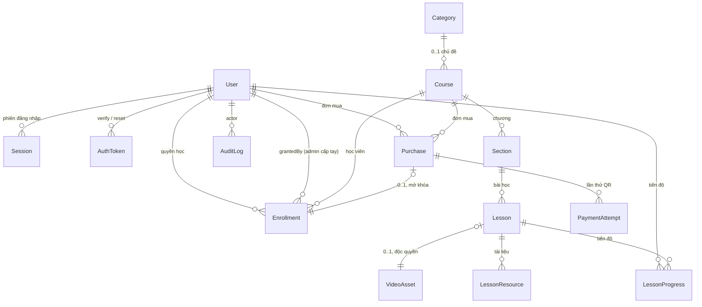

# Mô hình dữ liệu

Tài liệu này chi tiết hóa mục **Mô hình dữ liệu đề xuất** trong [`PROJECT_PLAN.md`](./PROJECT_PLAN.md). Kế hoạch đó liệt kê 13 model nhưng không có chi tiết cấp field; `schema.prisma` hiện chỉ có 2 model đã migrate (`User`, `Session`). Tài liệu này là nguồn sự thật cho toàn bộ phần còn lại.

Khi mâu thuẫn với [`PLAN_SUPPLEMENT.md`](./PLAN_SUPPLEMENT.md) hoặc [`UX_PLAN.md`](./UX_PLAN.md) về schema, **tài liệu này thắng** — đúng theo bảng quyền sở hữu ở `PLAN_SUPPLEMENT.md` §0, vốn đã trao chủ đề "schema, enum, index, cascade, migration, seed" cho tài liệu này. Mỗi chỗ thắng đều được liệt kê tường minh ở mục dưới; không có override im lặng.

Không lặp lại các quyết định đã có trong kế hoạch: PostgreSQL, UUID khóa nội bộ, tiền là số nguyên VND, thời gian là `timestamptz`, email lowercase trước khi unique, `prisma migrate deploy` khi triển khai và không dùng `db push` trên production.

## Khác biệt so với PROJECT_PLAN.md

Năm điểm dưới đây mở rộng hoặc tinh chỉnh kế hoạch. Không có điểm nào mâu thuẫn với một quyết định kiến trúc của kế hoạch.

| # | Kế hoạch nói | Tài liệu này quyết định | Lý do |
|---|---|---|---|
| 1 | Không có `Category` | Thêm `Category`, quan hệ `Course.categoryId` (many-to-one), không có bảng nối | Quyết định catalog kiểu Udemy cần duyệt theo chủ đề. Một khóa thuộc đúng một chủ đề nên bảng nối chỉ thêm một join và một unique constraint không bảo vệ gì |
| 2 | `Enrollment` tham chiếu `paymentAttemptId` | `Enrollment.purchaseId` | `Purchase` mới là mức nghiệp vụ và đã mang unique `(userId, courseId)`; attempt thành công truy được qua `Purchase`. Tránh hai đường dẫn cùng chỉ một sự kiện |
| 3 | Đánh giá/bình luận để sau | Không có model `Review`, nhưng `Course` có `ratingAverage`, `ratingCount`, `enrollmentCount` phi chuẩn hóa | Card khóa học kiểu Udemy cần hiển thị sao và số học viên ngay bản đầu. Đây là ba cột đọc-ghi bởi admin/seed, sau này được `Review` tính lại |
| 4 | `VideoAsset` có Cloudflare UID unique | `VideoAsset` có `provider` + unique `(provider, externalId)` | Quyết định demo-first: bản ghi demo và bản ghi Cloudflare thật cùng tồn tại trong một database. Không có cột `provider`, backend sẽ ký token Cloudflare cho một UID giả |
| 5 | Thứ tự phase: Thanh toán trước Trải nghiệm học | Thanh toán là migration cuối cùng | Quyết định của chủ sở hữu. `Enrollment` tồn tại từ phase học, nguồn duy nhất ban đầu là `MANUAL_GRANT` |

## Khác biệt so với PLAN_SUPPLEMENT.md và UX_PLAN.md

Hai tài liệu đó đề xuất tên cột và cấu trúc trước khi schema được chốt. Mười một điểm dưới đây là chỗ tài liệu này quyết khác. Dòng nào của hai tài liệu kia bị thay thì ghi rõ ở cột cuối — đó là danh sách sửa cho người bảo trì hai tài liệu đó, không phải danh sách tùy chọn.

| # | Tài liệu kia nói | Tài liệu này quyết định | Lý do | Cần sửa ở |
|---|---|---|---|---|
| 1 | `Category.parentId` — cây hai cấp, `Course.categoryId` bắt buộc và trỏ cấp 2 | **Một cấp.** Không có `parentId`; `categoryId` nullable | 8 chủ đề, một chủ sở hữu. Cây hai cấp thêm một self-relation, một ràng buộc "cha phải là gốc" mà database không ép được, và một cấp nav không có nội dung. `UX_PLAN` §0 cũng ghi "một cấp, không phân cấp con" — mâu thuẫn nằm trong `PLAN_SUPPLEMENT` §4.2, không nằm giữa UX và schema | `PLAN_SUPPLEMENT` §4.2, §5 |
| 2 | `Course.tags String[]` + GIN index | **Không có `tags`** | Không có trang tag, không có màn hình quản trị tag, không có bộ lọc tag trong `UX_PLAN` §4. Một cột chưa ai ghi và chưa ai đọc. "Khóa liên quan" đổi thành: cùng `categoryId`, `status = PUBLISHED`, sắp theo `enrollmentCount desc`, bỏ chính nó, lấy 4 | `PLAN_SUPPLEMENT` §4.2, §5, §7 |
| 3 | `Course.searchVector` — cột `tsvector` sinh tự động, extension `unaccent`, `websearch_to_tsquery` | **`Course.searchText VarChar(400)`** — bản đã bỏ dấu + lowercase, truy vấn `LIKE '%q%'` qua `contains` của Prisma | Xem mục *Tìm kiếm* dưới đây. Giải đúng vấn đề "người Việt gõ không dấu" mà `PLAN_SUPPLEMENT` §4.3 nêu, nhưng không cần `CREATE EXTENSION`, không cần `Unsupported()`, không cần `$queryRaw`. `PLAN_SUPPLEMENT` §4.3 đã chốt lại theo phương án này | `API_CONTRACT` §2.8 |
| 4 | `Course.isSeed Boolean` | **`Course.demoStats Boolean`** | `isSeed` trả lời "hàng này do script tạo ra", một sự thật về nguồn gốc không ai hành động theo. `demoStats` trả lời "số liệu trên hàng này là bịa", đúng câu mà UI phải hỏi trước khi vẽ sao. Xem *Quy tắc nhãn dữ liệu demo* | `PLAN_SUPPLEMENT` §4.4, §5 |
| 5 | `Course.ratingAverage Float?` | **`Decimal(2,1)`** | Một chữ số thập phân, hiển thị nguyên văn. `Float` đưa sai số nhị phân vào một con số chỉ có 51 giá trị hợp lệ | `PLAN_SUPPLEMENT` §4.4, §5 |
| 6 | `UX_PLAN`: `Course.summary` (≤ 200), `Course.studentCount`, `Course.ratingAvg` | **`subtitle` (240), `enrollmentCount`, `ratingAverage`** | Đổi tên, không đổi ngữ nghĩa. `subtitle` khớp từ vựng Udemy và khớp `API_CONTRACT`; `enrollmentCount` gọi đúng bảng đếm được (`Enrollment`, không phải "student"); `ratingAverage` viết đủ chữ như mọi field khác trong schema | `UX_PLAN` §0 |
| 7 | `UX_PLAN`: `CourseLevel` ba giá trị | **Bốn giá trị, thêm `ALL_LEVELS`** | Đây là default. Một khóa mới chưa phân loại phải có giá trị hợp lệ, và "Mọi cấp độ" là facet Udemy có thật, không phải giá trị rác | `UX_PLAN` §0 |
| 8 | `Enrollment.revokeReason` | **Không có cột.** Lý do nằm ở `AuditLog.metadata.reason` | `Enrollment` giữ **trạng thái hiện tại**; lý do là sự kiện. Thu hồi rồi cấp lại trên cùng một hàng sẽ xóa mất lý do cũ, còn `AuditLog` giữ đủ cả chuỗi. Đây là lý do `AuditLog` tồn tại | `PLAN_SUPPLEMENT` §5 |
| 9 | CHECK hai chiều trên `Enrollment.source` ở tầng database | **Ép ở tầng ứng dụng**, trong đúng một hàm `EnrollmentService.grant()` | Prisma 7.10 không khai báo được `CHECK` (`@@check` fail `prisma validate`, đã chạy thử). CHECK viết tay ở đây sẽ bị regenerate migration xóa mất, và nó bảo vệ một bất biến mà đúng một hàm ghi. Đổi lại: CHECK cho `priceVnd`/`amountVnd` **là** SQL tay bắt buộc, vì tiền âm là loại lỗi mà nhiều đường ghi có thể tạo ra. Xem §Chiến lược migration | `PLAN_SUPPLEMENT` §5, §6 |
| 10 | Bản đầu của **chính tài liệu này** thêm `Purchase.refundRequestedAt`, `refundReason`, `refundRejectedAt` | **Xóa cả ba.** Thay bằng đúng một giá trị enum `PurchaseStatus.REFUND_REQUESTED` | `PLAN_SUPPLEMENT` §4.5 và §5 chốt lại điều này và lập luận đứng vững: bốn cột nullable độc lập mã hóa một máy trạng thái năm trạng thái, cho phép `refundedAt` và `refundRejectedAt` cùng có giá trị, và cho phép hoàn tiền một đơn chưa ai yêu cầu. Lý do đi vào `AuditLog.metadata` | — (tài liệu này sửa) |
| 11 | `Purchase.buyerName/buyerEmail/buyerTaxCode/buyerAddress/invoiceRequested` | **Nhận đủ.** Bản đầu của tài liệu này bỏ sót | Nghĩa vụ hóa đơn `PLAN_SUPPLEMENT` §4.6 chặn hồ sơ merchant. Thông tin chỉ chụp được lúc checkout, không backfill được | — (tài liệu này sửa) |

## Sơ đồ quan hệ



Bản số cần nhớ:

| Quan hệ | Bản số | Ràng buộc bảo vệ |
|---|---|---|
| `User` — `Course` qua `Enrollment` | nhiều-nhiều, tối đa một hàng mỗi cặp | `@@unique([userId, courseId])` |
| `User` — `Course` qua `Purchase` | nhiều-nhiều, tối đa một đơn **đang mở** mỗi cặp | Unique **một phần** viết tay: `(user_id, course_id) WHERE status IN ('PENDING','PAID','REFUND_REQUESTED')` |
| `Purchase` — `Enrollment` | 1 : 0..1 | `Enrollment.purchaseId @unique` |
| `Lesson` — `VideoAsset` | 1 : 0..1, độc quyền | `Lesson.videoAssetId @unique` |
| `Section` — `Lesson` | 1 : n, có thứ tự chặt | `@@unique([sectionId, position])` |
| `Course` — `Category` | n : 0..1 | FK `Restrict` |

## Quy ước schema

Kế thừa nguyên văn từ hai model đã migrate. Mọi model mới phải tuân thủ:

| Quy ước | Giá trị |
|---|---|
| Khóa chính | `String @id @default(uuid()) @db.Uuid` |
| Tên cột | `@map("snake_case")` trên **mọi** field có tên nhiều từ |
| Tên bảng | `@@map("snake_case_số_nhiều")` trên **mọi** model |
| Thời gian | `DateTime @db.Timestamptz(3)` |
| Tạo/sửa | `createdAt @default(now())`, `updatedAt @updatedAt` |
| Tiền | `Int`, hậu tố `Vnd`, cột `*_vnd`. `Int` đủ tới 2.147.483.647 VND |
| Enum | SCREAMING_CASE, tên type PascalCase |
| Index | Khai báo tường minh bằng `@@index` / `@@unique`, không dựa vào index ngầm ngoài PK và `@unique` |
| Text dài | `@db.Text` cho Markdown, `@db.VarChar(n)` cho mọi chuỗi có trần độ dài |
| JSON | `Json? @db.JsonB` |
| `position` | `Int`, **bắt đầu từ 1**, liên tiếp, không có khoảng trống. Endpoint reorder từ chối `0` và số âm |
| `CHECK` | Không khai báo được trong Prisma 7.10 (`@@check` fail `prisma validate`). Mọi `CHECK` nằm trong SQL viết tay, liệt kê ở §Chiến lược migration |

### Cột `provider` / `storage` ánh xạ sang biến môi trường nào

Cột trên bản ghi **không** dùng để chọn driver — driver chọn bằng env, một instance cho cả process (`PLAN_SUPPLEMENT.md` §3, đính chính 3). Bảng này chỉ để đọc ngược: thấy một hàng có giá trị enum này thì nó do driver nào sinh ra.

| Giá trị enum | Biến env | Giá trị env |
|---|---|---|
| `VideoProvider.DEMO` | `VIDEO_DRIVER` | `demo` |
| `VideoProvider.CLOUDFLARE_STREAM` | `VIDEO_DRIVER` | `cloudflare` |
| `StorageProvider.DEMO` | `STORAGE_DRIVER` | `demo` |
| `StorageProvider.CLOUDFLARE_R2` | `STORAGE_DRIVER` | `r2` |
| `PaymentProvider.DEMO` | `PAYMENT_DRIVER` | `demo` |
| `PaymentProvider.ZALOPAY` | `PAYMENT_DRIVER` | `zalopay` |

Tên biến lấy từ `DEMO_MODE.md` §7 — tài liệu sở hữu `.env.example`. `ROADMAP.md` §2.3 đã được đối chiếu và hiện dùng `STORAGE_DRIVER=demo`, khớp với `API_CONTRACT.md` §5.6. Không có biến `MEDIA_DRIVER` trong dự án.

## Prisma schema đầy đủ

Đây là trạng thái đích của `apps/api/prisma/schema.prisma`. Khối `User` và `Session` giữ nguyên từng ký tự so với bản đã migrate; chỉ thêm các field quan hệ (không sinh cột).

```prisma
generator client {
  provider = "prisma-client"
  output   = "../src/generated/prisma"
}

datasource db {
  provider = "postgresql"
}

enum UserRole {
  STUDENT
  ADMIN
}

enum UserStatus {
  ACTIVE
  BLOCKED
}

enum AuthTokenType {
  EMAIL_VERIFICATION
  PASSWORD_RESET
}

enum CourseStatus {
  DRAFT
  PUBLISHED
  ARCHIVED
}

enum CourseLevel {
  BEGINNER
  INTERMEDIATE
  ADVANCED
  ALL_LEVELS
}

enum LessonType {
  VIDEO
  ARTICLE
}

enum VideoProvider {
  DEMO
  CLOUDFLARE_STREAM
}

enum VideoAssetStatus {
  PENDING
  PROCESSING
  READY
  ERRORED
}

enum StorageProvider {
  DEMO
  CLOUDFLARE_R2
}

enum EnrollmentStatus {
  ACTIVE
  REVOKED
}

enum EnrollmentSource {
  PURCHASE
  MANUAL_GRANT
}

enum PurchaseStatus {
  PENDING
  PAID
  REFUND_REQUESTED
  REFUNDED
  CANCELLED
}

enum PaymentProvider {
  DEMO
  ZALOPAY
}

enum PaymentAttemptStatus {
  PENDING
  SUCCEEDED
  FAILED
  EXPIRED
  CANCELLED
}

model User {
  id              String     @id @default(uuid()) @db.Uuid
  email           String     @unique @db.VarChar(320)
  passwordHash    String     @map("password_hash")
  displayName     String     @map("display_name") @db.VarChar(80)
  role            UserRole   @default(STUDENT)
  status          UserStatus @default(ACTIVE)
  emailVerifiedAt DateTime?  @map("email_verified_at") @db.Timestamptz(3)
  createdAt       DateTime   @default(now()) @map("created_at") @db.Timestamptz(3)
  updatedAt       DateTime   @updatedAt @map("updated_at") @db.Timestamptz(3)

  sessions           Session[]
  authTokens         AuthToken[]
  enrollments        Enrollment[]     @relation("EnrollmentStudent")
  grantedEnrollments Enrollment[]     @relation("EnrollmentGrantedBy")
  lessonProgress     LessonProgress[]
  purchases          Purchase[]
  auditLogs          AuditLog[]

  @@map("users")
}

model Session {
  id        String    @id @default(uuid()) @db.Uuid
  userId    String    @map("user_id") @db.Uuid
  expiresAt DateTime  @map("expires_at") @db.Timestamptz(3)
  revokedAt DateTime? @map("revoked_at") @db.Timestamptz(3)
  createdAt DateTime  @default(now()) @map("created_at") @db.Timestamptz(3)
  user      User      @relation(fields: [userId], references: [id], onDelete: Cascade)

  @@index([userId])
  @@index([expiresAt])
  @@map("sessions")
}

model AuthToken {
  id         String        @id @default(uuid()) @db.Uuid
  userId     String        @map("user_id") @db.Uuid
  type       AuthTokenType
  tokenHash  String        @unique @map("token_hash") @db.Char(64)
  expiresAt  DateTime      @map("expires_at") @db.Timestamptz(3)
  consumedAt DateTime?     @map("consumed_at") @db.Timestamptz(3)
  createdAt  DateTime      @default(now()) @map("created_at") @db.Timestamptz(3)
  user       User          @relation(fields: [userId], references: [id], onDelete: Cascade)

  @@index([userId, type])
  @@index([expiresAt])
  @@map("auth_tokens")
}

model Category {
  id          String   @id @default(uuid()) @db.Uuid
  slug        String   @unique @db.VarChar(80)
  name        String   @db.VarChar(80)
  description String?  @db.VarChar(280)
  icon        String?  @db.VarChar(40)
  position    Int
  createdAt   DateTime @default(now()) @map("created_at") @db.Timestamptz(3)
  updatedAt   DateTime @updatedAt @map("updated_at") @db.Timestamptz(3)
  courses     Course[]

  @@index([position])
  @@map("categories")
}

model Course {
  id                   String           @id @default(uuid()) @db.Uuid
  categoryId           String?          @map("category_id") @db.Uuid
  slug                 String           @unique @db.VarChar(120)
  title                String           @db.VarChar(160)
  subtitle             String?          @db.VarChar(240)
  description          String           @db.Text
  searchText           String           @default("") @map("search_text") @db.VarChar(400)
  level                CourseLevel      @default(ALL_LEVELS)
  language             String           @default("vi") @db.VarChar(10)
  learningOutcomes     String[]         @map("learning_outcomes")
  requirements         String[]
  targetAudience       String[]         @map("target_audience")
  priceVnd             Int              @map("price_vnd")
  compareAtPriceVnd    Int?             @map("compare_at_price_vnd")
  status               CourseStatus     @default(DRAFT)
  coverImageStorage    StorageProvider? @map("cover_image_storage")
  coverImageKey        String?          @map("cover_image_key") @db.VarChar(400)
  lessonCount          Int              @default(0) @map("lesson_count")
  totalDurationSeconds Int              @default(0) @map("total_duration_seconds")
  enrollmentCount      Int              @default(0) @map("enrollment_count")
  ratingAverage        Decimal?         @map("rating_average") @db.Decimal(2, 1)
  ratingCount          Int              @default(0) @map("rating_count")
  demoStats            Boolean          @default(false) @map("demo_stats")
  publishedAt          DateTime?        @map("published_at") @db.Timestamptz(3)
  archivedAt           DateTime?        @map("archived_at") @db.Timestamptz(3)
  createdAt            DateTime         @default(now()) @map("created_at") @db.Timestamptz(3)
  updatedAt            DateTime         @updatedAt @map("updated_at") @db.Timestamptz(3)

  category    Category?    @relation(fields: [categoryId], references: [id], onDelete: Restrict)
  sections    Section[]
  enrollments Enrollment[]
  purchases   Purchase[]

  @@index([status, publishedAt])
  @@index([categoryId, status])
  @@map("courses")
}

model Section {
  id        String   @id @default(uuid()) @db.Uuid
  courseId  String   @map("course_id") @db.Uuid
  title     String   @db.VarChar(160)
  position  Int
  createdAt DateTime @default(now()) @map("created_at") @db.Timestamptz(3)
  updatedAt DateTime @updatedAt @map("updated_at") @db.Timestamptz(3)
  course    Course   @relation(fields: [courseId], references: [id], onDelete: Cascade)
  lessons   Lesson[]

  @@unique([courseId, position])
  @@map("sections")
}

model Lesson {
  id              String     @id @default(uuid()) @db.Uuid
  sectionId       String     @map("section_id") @db.Uuid
  videoAssetId    String?    @unique @map("video_asset_id") @db.Uuid
  title           String     @db.VarChar(160)
  type            LessonType @default(VIDEO)
  content         String?    @db.Text
  isPreview       Boolean    @default(false) @map("is_preview")
  durationSeconds Int        @default(0) @map("duration_seconds")
  position        Int
  createdAt       DateTime   @default(now()) @map("created_at") @db.Timestamptz(3)
  updatedAt       DateTime   @updatedAt @map("updated_at") @db.Timestamptz(3)

  section    Section          @relation(fields: [sectionId], references: [id], onDelete: Cascade)
  videoAsset VideoAsset?      @relation(fields: [videoAssetId], references: [id], onDelete: Restrict)
  resources  LessonResource[]
  progress   LessonProgress[]

  @@unique([sectionId, position])
  @@map("lessons")
}

model VideoAsset {
  id              String           @id @default(uuid()) @db.Uuid
  provider        VideoProvider    @default(DEMO)
  externalId      String           @map("external_id") @db.VarChar(120)
  status          VideoAssetStatus @default(PENDING)
  durationSeconds Int              @default(0) @map("duration_seconds")
  thumbnailUrl    String?          @map("thumbnail_url") @db.VarChar(500)
  createdAt       DateTime         @default(now()) @map("created_at") @db.Timestamptz(3)
  updatedAt       DateTime         @updatedAt @map("updated_at") @db.Timestamptz(3)
  lesson          Lesson?

  @@unique([provider, externalId])
  @@map("video_assets")
}

model LessonResource {
  id          String          @id @default(uuid()) @db.Uuid
  lessonId    String          @map("lesson_id") @db.Uuid
  storage     StorageProvider @default(DEMO)
  objectKey   String          @map("object_key") @db.VarChar(400)
  filename    String          @db.VarChar(200)
  contentType String          @map("content_type") @db.VarChar(120)
  sizeBytes   Int             @map("size_bytes")
  position    Int
  createdAt   DateTime        @default(now()) @map("created_at") @db.Timestamptz(3)
  updatedAt   DateTime        @updatedAt @map("updated_at") @db.Timestamptz(3)
  lesson      Lesson          @relation(fields: [lessonId], references: [id], onDelete: Cascade)

  @@unique([lessonId, position])
  @@unique([storage, objectKey])
  @@map("lesson_resources")
}

model Enrollment {
  id          String           @id @default(uuid()) @db.Uuid
  userId      String           @map("user_id") @db.Uuid
  courseId    String           @map("course_id") @db.Uuid
  purchaseId  String?          @unique @map("purchase_id") @db.Uuid
  grantedById String?          @map("granted_by_id") @db.Uuid
  status      EnrollmentStatus @default(ACTIVE)
  source      EnrollmentSource
  grantedAt   DateTime         @default(now()) @map("granted_at") @db.Timestamptz(3)
  revokedAt   DateTime?        @map("revoked_at") @db.Timestamptz(3)
  createdAt   DateTime         @default(now()) @map("created_at") @db.Timestamptz(3)
  updatedAt   DateTime         @updatedAt @map("updated_at") @db.Timestamptz(3)

  user      User      @relation("EnrollmentStudent", fields: [userId], references: [id], onDelete: Restrict)
  course    Course    @relation(fields: [courseId], references: [id], onDelete: Restrict)
  purchase  Purchase? @relation(fields: [purchaseId], references: [id], onDelete: Restrict)
  grantedBy User?     @relation("EnrollmentGrantedBy", fields: [grantedById], references: [id], onDelete: SetNull)

  @@unique([userId, courseId])
  @@index([courseId])
  @@map("enrollments")
}

model LessonProgress {
  id                  String    @id @default(uuid()) @db.Uuid
  userId              String    @map("user_id") @db.Uuid
  lessonId            String    @map("lesson_id") @db.Uuid
  lastPositionSeconds Int       @default(0) @map("last_position_seconds")
  completedAt         DateTime? @map("completed_at") @db.Timestamptz(3)
  createdAt           DateTime  @default(now()) @map("created_at") @db.Timestamptz(3)
  updatedAt           DateTime  @updatedAt @map("updated_at") @db.Timestamptz(3)

  user   User   @relation(fields: [userId], references: [id], onDelete: Cascade)
  lesson Lesson @relation(fields: [lessonId], references: [id], onDelete: Cascade)

  @@unique([userId, lessonId])
  @@index([userId, updatedAt])
  @@map("lesson_progress")
}

model Purchase {
  id                String         @id @default(uuid()) @db.Uuid
  userId            String         @map("user_id") @db.Uuid
  courseId          String         @map("course_id") @db.Uuid
  status            PurchaseStatus @default(PENDING)
  priceVnd          Int            @map("price_vnd")
  paidAt            DateTime?      @map("paid_at") @db.Timestamptz(3)
  refundedAt        DateTime?      @map("refunded_at") @db.Timestamptz(3)
  buyerName         String?        @map("buyer_name") @db.VarChar(120)
  buyerEmail        String?        @map("buyer_email") @db.VarChar(320)
  buyerTaxCode      String?        @map("buyer_tax_code") @db.VarChar(20)
  buyerAddress      String?        @map("buyer_address") @db.VarChar(300)
  invoiceRequested  Boolean        @default(false) @map("invoice_requested")
  createdAt         DateTime       @default(now()) @map("created_at") @db.Timestamptz(3)
  updatedAt         DateTime       @updatedAt @map("updated_at") @db.Timestamptz(3)

  user       User             @relation(fields: [userId], references: [id], onDelete: Restrict)
  course     Course           @relation(fields: [courseId], references: [id], onDelete: Restrict)
  attempts   PaymentAttempt[]
  enrollment Enrollment?

  @@index([userId, courseId])
  @@index([status, createdAt])
  @@map("purchases")
}

model PaymentAttempt {
  id              String               @id @default(uuid()) @db.Uuid
  purchaseId      String               @map("purchase_id") @db.Uuid
  provider        PaymentProvider      @default(DEMO)
  appTransId      String               @unique @map("app_trans_id") @db.VarChar(64)
  providerTransId String?              @unique @map("provider_trans_id") @db.VarChar(64)
  amountVnd       Int                  @map("amount_vnd")
  status          PaymentAttemptStatus @default(PENDING)
  qrCode          String?              @map("qr_code") @db.Text
  orderUrl        String?              @map("order_url") @db.VarChar(1000)
  expiresAt       DateTime             @map("expires_at") @db.Timestamptz(3)
  paidAt          DateTime?            @map("paid_at") @db.Timestamptz(3)
  failureReason   String?              @map("failure_reason") @db.VarChar(200)
  providerPayload Json?                @map("provider_payload") @db.JsonB
  createdAt       DateTime             @default(now()) @map("created_at") @db.Timestamptz(3)
  updatedAt       DateTime             @updatedAt @map("updated_at") @db.Timestamptz(3)
  purchase        Purchase             @relation(fields: [purchaseId], references: [id], onDelete: Cascade)

  @@index([purchaseId])
  @@index([status, expiresAt])
  @@map("payment_attempts")
}

model AuditLog {
  id         String   @id @default(uuid()) @db.Uuid
  actorId    String?  @map("actor_id") @db.Uuid
  action     String   @db.VarChar(64)
  entityType String   @map("entity_type") @db.VarChar(40)
  entityId   String?  @map("entity_id") @db.Uuid
  metadata   Json?    @db.JsonB
  ipAddress  String?  @map("ip_address") @db.VarChar(45)
  createdAt  DateTime @default(now()) @map("created_at") @db.Timestamptz(3)
  actor      User?    @relation(fields: [actorId], references: [id], onDelete: SetNull)

  @@index([entityType, entityId])
  @@index([createdAt])
  @@map("audit_logs")
}
```

Kết quả sau khi áp dụng: 14 bảng, 14 enum, 30 index/unique, 17 foreign key.

Prisma không sinh được ba loại đối tượng dưới đây; chúng là SQL **viết tay bắt buộc**, nối vào cuối file `migration.sql` do `prisma migrate dev` tạo ra, và có một dòng riêng trong §Chiến lược migration để không ai regenerate migration rồi làm mất:

| Đối tượng | Migration | Câu lệnh |
|---|---|---|
| Unique một phần trên `purchases` | `add_payment` | `CREATE UNIQUE INDEX "purchases_user_course_open_key" ON "purchases" ("user_id", "course_id") WHERE "status" IN ('PENDING','PAID','REFUND_REQUESTED');` |
| 4 `CHECK` giá tiền | `add_catalog`, `add_payment` | Xem §Chiến lược migration |

## Chi tiết từng model

Quy ước ký hiệu: `NN` = NOT NULL, `U` = unique, `FK` = khóa ngoại.

### User

Không thêm cột nào. Chỉ thêm bảy field quan hệ. Thông tin giảng viên (tiểu sử, ảnh, liên kết mạng xã hội) **không** nằm trong database: hệ thống có đúng một chủ sở hữu nên đó là nội dung tĩnh của `apps/web`, không phải dữ liệu.

Bất biến database: `email` unique. Bất biến ứng dụng: email lowercase + trim trước khi ghi (đã có trong `AuthService.normalizeEmail`), tài khoản `ADMIN` chỉ được tạo bằng seed/CLI.

### AuthToken

| Field | Kiểu | NN | Ràng buộc | Vì sao tồn tại |
|---|---|---|---|---|
| `id` | `uuid` | ✓ | PK | |
| `userId` | `uuid` | ✓ | FK → `users` Cascade | Token thuộc về một người |
| `type` | `AuthTokenType` | ✓ | | Một bảng dùng cho cả verify email và reset password |
| `tokenHash` | `char(64)` | ✓ | U | SHA-256 hex của token gửi qua email. Không bao giờ lưu token thô |
| `expiresAt` | `timestamptz(3)` | ✓ | | Hạn dùng |
| `consumedAt` | `timestamptz(3)` | | | Đánh dấu đã dùng, không xóa hàng để còn dấu vết |
| `createdAt` | `timestamptz(3)` | ✓ | | |

Database bảo đảm: hai token không thể trùng hash. Ứng dụng bảo đảm: token chỉ tiêu thụ được một lần, bằng `updateMany({ where: { tokenHash, consumedAt: null }, data: { consumedAt: now } })` và kiểm tra `count === 1` — điều kiện `consumedAt: null` nằm trong mệnh đề `WHERE` nên thao tác là nguyên tử, không cần khóa. Ứng dụng cũng thu hồi mọi token `PASSWORD_RESET` còn sống khi phát một token mới.

### Category

| Field | Kiểu | NN | Ràng buộc | Vì sao tồn tại |
|---|---|---|---|---|
| `id` | `uuid` | ✓ | PK | |
| `slug` | `varchar(80)` | ✓ | U | URL `/categories/[slug]` (`UX_PLAN.md` §2.2 sở hữu tên trang) và SEO |
| `name` | `varchar(80)` | ✓ | | Nhãn tiếng Việt |
| `description` | `varchar(280)` | | | Meta description trang chủ đề |
| `icon` | `varchar(40)` | | | Tên icon Lucide, ví dụ `code-2`. Không lưu SVG, không emoji |
| `position` | `int` | ✓ | | Thứ tự trong hero và trong nav |
| `createdAt` / `updatedAt` | `timestamptz(3)` | ✓ | | |

Không có `parentId`: catalog một chủ sở hữu với khoảng 8 chủ đề không cần cây hai cấp. Nâng cấp khi số khóa vượt ~30 và nav phẳng trở nên dài.

`position` **không** unique — khác với `Section`/`Lesson`. Danh sách chủ đề ngắn, đổi thứ tự hiếm, và unique buộc phải làm thủ tục hai pha cho một lợi ích không có. Ứng dụng chuẩn hóa lại `position` thành dãy liên tiếp sau mỗi lần sắp xếp.

### Course

| Field | Kiểu | NN | Ràng buộc | Vì sao tồn tại |
|---|---|---|---|---|
| `id` | `uuid` | ✓ | PK | |
| `categoryId` | `uuid` | | FK → `categories` Restrict | Nullable để tạo draft trước khi chọn chủ đề |
| `slug` | `varchar(120)` | ✓ | U | URL công khai, SEO |
| `title` | `varchar(160)` | ✓ | | |
| `subtitle` | `varchar(240)` | | | Dòng headline trên card và hero trang chi tiết |
| `description` | `text` | ✓ | | Markdown, render có sanitize |
| `searchText` | `varchar(400)` | ✓ | default `''` | `title` + `subtitle` đã bỏ dấu và lowercase. Cột duy nhất mà `?q=` chạm tới |
| `level` | `CourseLevel` | ✓ | default `ALL_LEVELS` | Facet lọc kiểu Udemy |
| `language` | `varchar(10)` | ✓ | default `vi` | Mã BCP-47 rút gọn, hiển thị trên card |
| `learningOutcomes` | `text[]` | ✓ | ≤ 12 phần tử, mỗi phần tử ≤ 200 ký tự | Khối "Bạn sẽ học được gì" |
| `requirements` | `text[]` | ✓ | ≤ 8 phần tử, mỗi phần tử ≤ 200 ký tự | Khối "Yêu cầu" |
| `targetAudience` | `text[]` | ✓ | ≤ 8 phần tử, mỗi phần tử ≤ 200 ký tự | Khối "Khóa học dành cho ai" |
| `priceVnd` | `int` | ✓ | `CHECK >= 0` | Giá hiện tại. `CHECK` chặn giá âm ở **mọi** trạng thái; cổng publish thì đòi chặt hơn — `priceVnd > 0`, vì không có đường ghi danh nào cho khóa 0 đồng (`PLAN_SUPPLEMENT.md` §5) |
| `compareAtPriceVnd` | `int` | | | Giá gạch ngang để tính % giảm trên card |
| `status` | `CourseStatus` | ✓ | default `DRAFT` | |
| `coverImageStorage` | `StorageProvider` | | | Driver nào sinh ra key này |
| `coverImageKey` | `varchar(400)` | | | Object key R2 hoặc đường dẫn file demo |
| `lessonCount` | `int` | ✓ | default 0 | Card hiển thị "N bài học" |
| `totalDurationSeconds` | `int` | ✓ | default 0 | Card hiển thị tổng thời lượng và là facet lọc theo độ dài |
| `enrollmentCount` | `int` | ✓ | default 0 | Card hiển thị số học viên và là khóa sắp xếp phổ biến |
| `ratingAverage` | `decimal(2,1)` | | | Sao trên card. `decimal` để không có sai số dấu phẩy động |
| `ratingCount` | `int` | ✓ | default 0 | Số lượt đánh giá |
| `demoStats` | `bool` | ✓ | default `false` | **Chỉ** `ratingAverage` và `ratingCount` là số bịa. `enrollmentCount` luôn thật |
| `publishedAt` | `timestamptz(3)` | | | Thời điểm publish lần đầu, dùng để sắp xếp catalog |
| `archivedAt` | `timestamptz(3)` | | | Thời điểm archive |
| `createdAt` / `updatedAt` | `timestamptz(3)` | ✓ | | |

Ba mảng `text[]` thay cho ba bảng con: chuỗi ngắn có thứ tự, không có định danh riêng, không bao giờ được truy vấn độc lập. Bảng con chỉ thêm join và một cột `position` nữa.

Trần độ dài của ba mảng là **quy tắc validate DTO**, không phải ràng buộc database — PostgreSQL không giới hạn được độ dài phần tử của `text[]` mà không viết một `CHECK` dùng `array_length` cộng một subquery, đắt hơn giá trị nó bảo vệ. Quy tắc, áp trong `course.dto.ts` và tham chiếu từ `API_CONTRACT.md` §5.3: `@ArrayMaxSize(12|8|8)` + `@MaxLength(200, { each: true })`; phần tử rỗng hoặc chỉ có khoảng trắng bị **loại bỏ trước khi ghi**, không bị coi là lỗi validate — dán từ Word luôn kèm dòng trống, và bắt người dùng sửa việc đó là bắt sai chỗ.

Database bảo đảm: `slug` unique; không thể trỏ tới `categoryId` không tồn tại.

Ứng dụng bảo đảm:

- Chuyển sang `PUBLISHED` chỉ khi `categoryId` khác null, `description` khác rỗng, `learningOutcomes` có ≥ 1 phần tử, **`priceVnd > 0`**, có ≥ 1 `Section` chứa ≥ 1 `Lesson`, mọi `Lesson` kiểu `VIDEO` có `VideoAsset.status = READY`, và có ≥ 1 bài `isPreview`. Danh sách đầy đủ kèm mã `issues[].field` nằm ở `API_CONTRACT.md` §5.3.
- `compareAtPriceVnd`, nếu có, phải lớn hơn `priceVnd`.
- `lessonCount`, `totalDurationSeconds`, `searchText` được tính lại bởi **một** hàm duy nhất, gọi trong cùng transaction với mọi thao tác tạo/xóa/sửa `Lesson`, mọi thao tác gắn/gỡ `VideoAsset`, và mọi thao tác sửa `title`/`subtitle`.
- `totalDurationSeconds` cộng dồn `Lesson.durationSeconds`, mà bài `ARTICLE` luôn bằng `0` — nên tổng thời lượng là **thời lượng video**, không phải thời lượng khóa học. Nhãn trên card đọc "N giờ video".
- `enrollmentCount` tăng/giảm trong cùng transaction với `Enrollment` chuyển sang/rời khỏi `ACTIVE`. Đây là số **thật ở mọi thời điểm**, kể cả trên khóa seed; xem §Quy tắc nhãn dữ liệu demo.
- `publishedAt` chỉ đặt một lần, ở lần publish đầu tiên; unpublish không xóa nó.

Chuyển trạng thái của `CourseStatus`: xem §Chuyển trạng thái.

`priceVnd >= 0` và `compareAtPriceVnd > priceVnd` **được ép ở tầng database**, đúng như `PROJECT_PLAN.md` yêu cầu ("database bảo vệ: không có giá âm") và như acceptance test N2.7 của `ROADMAP.md` đòi. Prisma 7.10 không khai báo được `CHECK` — `@@check(n >= 0)` làm `prisma validate` báo *"This line is not a valid field or attribute definition"*, đã chạy thử trên đúng phiên bản này — nên hai `CHECK` nằm trong SQL viết tay nối vào cuối `add_catalog/migration.sql`. Chúng là **bắt buộc**, không phải tùy chọn; §Chiến lược migration liệt kê nguyên văn để lần regenerate migration sau không đánh rơi.

#### Tìm kiếm: `searchText`, không `tsvector`

Quyết định chốt ở đây vì đây là tài liệu quyết cột nào tồn tại. Bản đầu của `PLAN_SUPPLEMENT.md` §4.3 chọn `tsvector` + `unaccent`, bản đầu của `API_CONTRACT.md` §2.8 chọn `ILIKE` qua `unaccent`. Cả hai đã sửa theo phương án dưới đây. **Chọn `searchText`.**

Lý do đứng trên bản đầu của `PLAN_SUPPLEMENT` §4.3: lập luận của mục đó đúng — `LIKE '%lap trinh%'` trên `title` thô không khớp "Lập trình", và đó là lỗi sản phẩm chứ không phải chuyện hiệu năng. `searchText` giải **đúng lỗi đó**: chuỗi đã bỏ dấu nằm sẵn trong cột, nên `LIKE '%lap trinh%'` khớp. Cái bị bác bỏ là so khớp trên `title` thô, không phải so khớp trên cột đã chuẩn hóa.

Lý do không chọn `tsvector`: nó cần `CREATE EXTENSION unaccent` (quyền mà database quản lý không phải lúc nào cũng cấp), một generated column mà Prisma phải khai bằng `Unsupported()` và không quản được, một câu `$queryRaw` cho mỗi lần tìm, và một `IMMUTABLE` wrapper quanh `unaccent` vì `unaccent` mặc định `STABLE` nên không dùng được trong generated column. Bốn thứ để đổi lấy khả năng xếp hạng theo trọng số trên một catalog dưới 500 khóa. `searchText` là một hàm chuẩn hóa thuần TypeScript, một cột `varchar`, không extension.

Cách sinh, trong `apps/api/src/catalog/search-text.ts`, dùng đúng một lần cho cả lúc ghi và lúc đọc query:

```
normalize(s) = s.normalize('NFD')
                .replace(/[\u0300-\u036f]/g, "")   // bỏ mọi dấu thanh, dấu mũ (combining marks)
                .replace(/[đĐ]/g, 'd')             // NFD không tách được đ
                .toLowerCase()
                .trim()
searchText   = normalize(title + ' ' + (subtitle ?? '')).slice(0, 400)
```

`đ`/`Đ` phải xử lý riêng: `NFD` **không** tách chúng vì `đ` là một ký tự cơ sở, không phải chữ cái mang dấu. Bỏ dòng đó thì "học lập trình" tìm được còn "đọc hiểu" thì không — đúng loại lỗi lọt qua test viết bằng tiếng Anh.

Truy vấn: `where: { status: 'PUBLISHED', searchText: { contains: normalize(q) } }` trong query builder có kiểu của Prisma, sinh ra `WHERE search_text LIKE '%' || $1 || '%'` — `LIKE` chứ không `ILIKE`, vì cả hai vế đã lowercase và `LIKE` không phải gọi hàm hạ chữ trên từng hàng. Không `mode: 'insensitive'`, không `$queryRaw`: đi qua query builder nghĩa là không có bề mặt SQL injection trên endpoint công khai và không thể quên mệnh đề `status`.

### Section

| Field | Kiểu | NN | Ràng buộc | Vì sao tồn tại |
|---|---|---|---|---|
| `id` | `uuid` | ✓ | PK | |
| `courseId` | `uuid` | ✓ | FK → `courses` Cascade | |
| `title` | `varchar(160)` | ✓ | | |
| `position` | `int` | ✓ | U cùng `courseId` | Thứ tự accordion curriculum |
| `createdAt` / `updatedAt` | `timestamptz(3)` | ✓ | | |

Database bảo đảm: trong một khóa không có hai chương cùng `position`, nên thứ tự hiển thị luôn xác định.

Ứng dụng bảo đảm: **thủ tục sắp xếp lại hai pha**. Unique constraint của PostgreSQL qua Prisma không `DEFERRABLE`, nên gán trực tiếp giá trị mới sẽ va chạm giữa chừng. Trong một transaction:

1. `UPDATE sections SET position = -(vị_trí_mới) - 1 WHERE id = ...` cho từng hàng.
2. `UPDATE sections SET position = -position - 1 WHERE course_id = $1 AND position < 0`.

Giá trị âm ở pha 1 phân biệt nhau nên không vi phạm unique. Áp dụng y hệt cho `Lesson` và `LessonResource`.

**Phần `- 1` không phải trang trí.** Nếu pha 1 chỉ viết `-(vị_trí_mới)` thì hàng chuyển về vị trí `0` được ghi `-0`, mà PostgreSQL lưu `-0` thành `0` — nó va ngay với hàng đang giữ `0` và cả transaction abort trên `sections_course_id_position_key`. Với offset `-1`, khoảng âm là `[-(n+1), -1]`, không bao giờ chạm `0`, nên thủ tục đúng bất kể `position` đếm từ `0` hay từ `1`. Quy ước của tài liệu này là đếm từ `1` (§Quy ước schema), nhưng thủ tục không được phép phụ thuộc vào việc mọi người nhớ quy ước đó.

### Lesson

| Field | Kiểu | NN | Ràng buộc | Vì sao tồn tại |
|---|---|---|---|---|
| `id` | `uuid` | ✓ | PK | |
| `sectionId` | `uuid` | ✓ | FK → `sections` Cascade | |
| `videoAssetId` | `uuid` | | U, FK → `video_assets` Restrict | Một video thuộc tối đa một bài |
| `title` | `varchar(160)` | ✓ | | |
| `type` | `LessonType` | ✓ | default `VIDEO` | Bài video hay bài viết |
| `content` | `text` | | | Markdown. Bắt buộc với `ARTICLE`, tùy chọn với `VIDEO` (ghi chú kèm) |
| `isPreview` | `bool` | ✓ | default `false` | Bài xem thử, mở cho khách chưa mua |
| `durationSeconds` | `int` | ✓ | default 0 | Video: sao chép từ `VideoAsset`. **`ARTICLE`: luôn `0`** |
| `position` | `int` | ✓ | U cùng `sectionId` | |
| `createdAt` / `updatedAt` | `timestamptz(3)` | ✓ | | |

`videoAssetId` unique bảo vệ một quy tắc thật: nếu hai bài dùng chung một `VideoAsset`, xóa bài này sẽ để lại bài kia trỏ vào một video mà admin tưởng đã gỡ. Muốn dùng lại video, tạo `VideoAsset` mới.

`durationSeconds` tồn tại độc lập với `VideoAsset.durationSeconds` để `Course.totalDurationSeconds` cộng dồn từ một bảng thay vì join ba bảng.

**Bài `ARTICLE` có `durationSeconds = 0`, không có thời gian đọc ước tính.** Bản đầu của tài liệu này nói ngược lại và mâu thuẫn với `UX_PLAN.md` §0 ("bài dạng article ghi 0, hiển thị *Bài đọc*") và §9.5 (nhãn `Bài đọc` hiện khi `durationSeconds = 0`). Chọn `0` vì phía kia đòi một hằng số từ/phút mà không ai đo được cho tiếng Việt, và vì một con số bịa hiển thị như một sự thật thì tệ hơn không hiển thị gì. Hệ quả: `Course.totalDurationSeconds` là tổng thời lượng **video**, và UI đọc `durationSeconds = 0` làm tín hiệu vẽ nhãn `Bài đọc`.

Ứng dụng bảo đảm:

- `type = ARTICLE` ⇒ `content` khác null, `videoAssetId` null, `durationSeconds = 0`.
- `type = VIDEO` ⇒ `videoAssetId` khác null trước khi publish; khi gắn `VideoAsset` thì chép `durationSeconds` sang.
- Đổi `type` từ `VIDEO` sang `ARTICLE` phải gỡ `videoAssetId` và đặt `durationSeconds = 0` trong cùng transaction, rồi gọi hàm tính lại của `Course`.

### VideoAsset

| Field | Kiểu | NN | Ràng buộc | Vì sao tồn tại |
|---|---|---|---|---|
| `id` | `uuid` | ✓ | PK | |
| `provider` | `VideoProvider` | ✓ | default `DEMO` | Bản ghi tự mô tả driver sinh ra nó |
| `externalId` | `varchar(120)` | ✓ | U cùng `provider` | Cloudflare Stream UID, hoặc định danh file demo |
| `status` | `VideoAssetStatus` | ✓ | default `PENDING` | Chặn publish khi video chưa encode xong |
| `durationSeconds` | `int` | ✓ | default 0 | |
| `thumbnailUrl` | `varchar(500)` | | | Ảnh poster của player |
| `createdAt` / `updatedAt` | `timestamptz(3)` | ✓ | | |

Database bảo đảm: cùng một UID Cloudflare không đăng ký được hai lần. Uniqueness phải gồm `provider` vì không gian định danh của driver demo và của Cloudflare là hai không gian khác nhau.

Ứng dụng bảo đảm: chỉ gọi Cloudflare API khi `provider = CLOUDFLARE_STREAM`; hàng `DEMO` được driver demo phục vụ từ file tĩnh và không bao giờ ký token. Đây là điều khiến chuyển `VIDEO_DRIVER` từ `demo` sang `cloudflare` không làm hỏng dữ liệu seed. Bảng ánh xạ enum ↔ biến env nằm ở §Quy ước schema.

`status = ERRORED` là trạng thái cuối: driver không retry trên cùng hàng. Admin gỡ `VideoAsset` khỏi bài rồi tạo hàng mới với `externalId` khác. Lý do là `externalId` bất biến — một UID Cloudflare đã encode lỗi thì encode lại vẫn ra lỗi đó, và giữ lại hàng cũ để đối chiếu rẻ hơn là dựng một bộ đếm retry.

### LessonResource

| Field | Kiểu | NN | Ràng buộc | Vì sao tồn tại |
|---|---|---|---|---|
| `id` | `uuid` | ✓ | PK | |
| `lessonId` | `uuid` | ✓ | FK → `lessons` Cascade | |
| `storage` | `StorageProvider` | ✓ | default `DEMO` | Cùng lý do như `VideoAsset.provider` |
| `objectKey` | `varchar(400)` | ✓ | U cùng `storage` | Key R2 hoặc đường dẫn file demo |
| `filename` | `varchar(200)` | ✓ | | Tên file khi tải xuống |
| `contentType` | `varchar(120)` | ✓ | allowlist 5 giá trị, xem dưới | Header `Content-Type` của presigned URL |
| `sizeBytes` | `int` | ✓ | ≤ 50 MB | Hiển thị dung lượng |
| `position` | `int` | ✓ | U cùng `lessonId` | Thứ tự danh sách tài liệu |
| `createdAt` / `updatedAt` | `timestamptz(3)` | ✓ | | `updatedAt` vì `position` bị ghi lại mỗi lần sắp xếp |

`@@unique([storage, objectKey])` bảo vệ việc dọn rác: không có hai hàng nào trỏ tới cùng một object, nên xóa hàng cuối cùng tham chiếu một object cũng có nghĩa là xóa object trên R2 an toàn.

**Allowlist `contentType`, ép ở DTO chứ không chỉ mô tả:** `application/pdf`, `application/zip`, `image/png`, `image/jpeg`, `text/plain`. Đây là ranh giới tin cậy, không phải chuyện thẩm mỹ: file do admin tải lên được phát lại cho học viên từ một URL đã ký, nên một `text/html` hay `image/svg+xml` lọt vào là một trang chạy script trên origin của mình. `API_CONTRACT.md` §5.6 hiện validate `contentType` của tài liệu bằng `@IsMimeType` — nhận mọi thứ — trong khi ảnh bìa ngay dòng trên đã dùng `@IsIn`; dòng đó phải đổi sang `@IsIn` trên đúng năm giá trị này.

Hai header bắt buộc khi phục vụ file: `Content-Disposition: attachment; filename="…"` và `X-Content-Type-Options: nosniff`. Cái thứ nhất khiến trình duyệt tải xuống thay vì render, cái thứ hai chặn nó tự đoán kiểu khác với header. Có cả hai thì allowlist là lớp phòng thủ thứ ba chứ không phải lớp duy nhất.

Trần `sizeBytes` là **50 MB**, không phải trần kỹ thuật 2 GB của `Int`. Tài liệu kèm bài học là slide, bài tập, mã nguồn; 50 MB đã rộng, và một trần chặt biến "upload nhầm file video 4 GB" thành lỗi ngay ở bước xin URL thay vì thành hóa đơn băng thông. Cùng hằng số `MAX_UPLOAD_BYTES` mà `API_CONTRACT.md` §5.6 tham chiếu.

### Enrollment

| Field | Kiểu | NN | Ràng buộc | Vì sao tồn tại |
|---|---|---|---|---|
| `id` | `uuid` | ✓ | PK | |
| `userId` | `uuid` | ✓ | FK → `users` Restrict | |
| `courseId` | `uuid` | ✓ | FK → `courses` Restrict | |
| `purchaseId` | `uuid` | | U, FK → `purchases` Restrict | Null với quyền cấp tay |
| `grantedById` | `uuid` | | FK → `users` SetNull | Admin đã cấp tay |
| `status` | `EnrollmentStatus` | ✓ | default `ACTIVE` | |
| `source` | `EnrollmentSource` | ✓ | | `PURCHASE` hoặc `MANUAL_GRANT` |
| `grantedAt` | `timestamptz(3)` | ✓ | | Mốc bắt đầu có quyền học |
| `revokedAt` | `timestamptz(3)` | | | |
| `createdAt` / `updatedAt` | `timestamptz(3)` | ✓ | | |

Đây là seam quan trọng nhất của quyết định "thanh toán làm cuối". Từ phase học, admin cấp quyền bằng `source = MANUAL_GRANT`; khi có checkout, đường `PURCHASE` chỉ thêm một nguồn, không đổi cách đọc quyền.

Database bảo đảm:

- `@@unique([userId, courseId])` — **một người có tối đa một hàng quyền học cho mỗi khóa**. Bước 10 của luồng thanh toán trong kế hoạch dùng `upsert` trên khóa unique này, nên callback lặp lại không **chèn** thêm hàng quyền học. Nhưng unique **không** chặn được việc nhánh `update` chạy hai lần và `Course.enrollmentCount` tăng hai lần — thứ chặn điều đó là ghi có điều kiện trên `PaymentAttempt`, xem §PaymentAttempt. Hai cơ chế, hai việc khác nhau; nhầm chúng làm một là lỗi mà bản đầu của tài liệu này mắc phải.
- `purchaseId` unique — **một đơn mua mở khóa tối đa một quyền học**. `NULL` không tính vào unique của PostgreSQL nên số lượng quyền cấp tay không giới hạn.

Ứng dụng bảo đảm: `source = PURCHASE` ⇒ `purchaseId` khác null và `Purchase.status = PAID`; `source = MANUAL_GRANT` ⇒ `grantedById` khác null; `status = REVOKED` ⇔ `revokedAt` khác null; mọi thay đổi ghi một hàng `AuditLog` trong cùng transaction.

#### Bảng chuyển trạng thái

`@@unique([userId, courseId])` nghĩa là **mọi** thao tác cấp quyền là một `upsert` chạm đúng một hàng. Bảng này nói rõ nhánh `update` ghi cột nào — nếu không, mỗi đường gọi tự nghĩ ra một câu trả lời khác nhau. Đúng một hàm `EnrollmentService.grant()` / `.revoke()` thực hiện, không có đường thứ hai.

| Thao tác | `status` | `source` | `purchaseId` | `grantedById` | `grantedAt` | `revokedAt` | `enrollmentCount` |
|---|---|---|---|---|---|---|---|
| Cấp tay, chưa có hàng | `ACTIVE` | `MANUAL_GRANT` | giữ `null` | id admin | `now()` | `null` | `+1` |
| Callback thanh toán, chưa có hàng | `ACTIVE` | `PURCHASE` | id đơn | giữ `null` | `now()` | `null` | `+1` |
| Callback thanh toán, **đã có hàng `MANUAL_GRANT` `ACTIVE`** | giữ `ACTIVE` | **`PURCHASE`** | id đơn | **giữ nguyên** | **giữ nguyên** | `null` | **`+0`** |
| Thu hồi (admin bấm, hoặc hoàn tiền) | `REVOKED` | giữ nguyên | giữ nguyên | giữ nguyên | giữ nguyên | `now()` | `−1` |
| Cấp lại sau khi `REVOKED` | `ACTIVE` | nguồn của lần cấp mới | theo nguồn mới | theo nguồn mới | **giữ nguyên** | **`null`** | `+1` |

Bốn quyết định trong bảng, mỗi cái một dòng lý do:

- **Mua sau khi được cấp tay thì `source` lật sang `PURCHASE`.** `source` trả lời "quyền học này hiện đang dựa vào đâu", và sau khi trả tiền thì nó dựa vào đơn mua — nếu không lật, hoàn tiền sẽ nhìn thấy một hàng `MANUAL_GRANT` và không biết mình có được phép thu hồi hay không.
- **`grantedById` giữ nguyên khi lật.** Nó là dấu vết lịch sử "ai đã từng cấp tay", không phải trạng thái hiện tại. Xóa nó là xóa bằng chứng.
- **`grantedAt` không bao giờ bị ghi lại.** Nó là "mốc bắt đầu có quyền học lần đầu" và là số duy nhất trả lời được "người này theo học bao lâu rồi". Muốn biết lần cấp gần nhất thì đọc `AuditLog`, đó là việc của nó.
- **Cấp lại không tăng `enrollmentCount` hai lần** vì thu hồi đã trừ. Bất biến kiểm được bằng một câu: `enrollmentCount` = số hàng `Enrollment` `ACTIVE` của khóa đó.

Nói thẳng, vì ba tài liệu khác đều dựa vào nó: **`Purchase.status = REFUNDED` ⇒ `Enrollment.status = REVOKED`, cùng một transaction, cùng một `AuditLog`.** Không có trạng thái trung gian nào mà đơn đã hoàn tiền còn quyền học vẫn `ACTIVE`.

#### Đọc quyền truy cập

Không phải một câu. Ba mệnh đề, và bỏ mệnh đề nào cũng là một lỗ thật:

1. `Course.status = PUBLISHED`, **hoặc** người gọi là `ADMIN`. Ngược lại → `404`.
2. **Và** (`lesson.isPreview = true` **hoặc** người gọi là `ADMIN` **hoặc** tồn tại `Enrollment` `ACTIVE` trên `(userId, courseId)`). Ngược lại → `403 NOT_ENROLLED`.
3. `LessonResource` và `LessonProgress` chỉ mở cho **nhánh Enrollment**, không bao giờ cho nhánh preview: bài preview trả `resources: []` và `progress: null`, và không sinh hàng `LessonProgress`. **Nhánh `ADMIN` đối xử y hệt nhánh preview**: trả `resources: []`, `progress: null`, `courseProgress.completedLessons = 0`, không sinh `LessonProgress`, không chạm `enrollmentCount` hay bất kỳ số liệu nào — lượt xem trước của chủ sở hữu không phải một lượt học.

Nhánh `ADMIN` ở mệnh đề 2 là đường xem trước, và bỏ nó là bỏ đúng thứ `PROJECT_PLAN.md` liệt kê trong phạm vi phase Catalog ("tạo, chỉnh sửa, **xem trước**, publish"): mệnh đề 1 đã miễn cho admin khóa chưa `PUBLISHED`, nhưng nếu mệnh đề 2 không miễn tiếp thì chủ sở hữu nhận `403 NOT_ENROLLED` trên mọi bài không phải preview của chính khóa mình vừa soạn. `PUT /lessons/{id}/progress` **không** có nhánh này — ghi tiến độ vẫn đòi `Enrollment` thật.

Thứ tự thi hành chuẩn là 8 bước ở `API_CONTRACT.md` §6.1 — tài liệu đó sở hữu thứ tự, tài liệu này sở hữu bất biến. Hai điểm dễ mất khi ai đó rút gọn thành "một câu":

- **Bỏ mệnh đề 1 là rò rỉ nội dung chưa publish.** `GET /lessons/{id}/content` và `POST /lessons/{id}/playback-token` đều nhận UUID bài trần, không đi qua slug khóa học; ai cầm UUID của một bài `isPreview` trong khóa `DRAFT` hoặc `ARCHIVED` sẽ đọc được nội dung chưa phát hành. Mệnh đề 1 áp cho **cả hai** endpoint, không riêng `playback-token`.
- **Bỏ mệnh đề 2 là giết bài xem thử.** `Lesson.isPreview` trở thành cột chết và trang chi tiết khóa học không còn gì để mời khách.

Bài preview vẫn yêu cầu đăng nhập (`API_CONTRACT.md` §6.1) — đó là ràng buộc về *ai gọi*, độc lập với ba mệnh đề trên về *gọi được gì*.

### LessonProgress

| Field | Kiểu | NN | Ràng buộc | Vì sao tồn tại |
|---|---|---|---|---|
| `id` | `uuid` | ✓ | PK | |
| `userId` | `uuid` | ✓ | FK → `users` Cascade | |
| `lessonId` | `uuid` | ✓ | FK → `lessons` Cascade | |
| `lastPositionSeconds` | `int` | ✓ | default 0 | Vị trí phát lại |
| `completedAt` | `timestamptz(3)` | | | Null nghĩa là chưa hoàn thành |
| `createdAt` / `updatedAt` | `timestamptz(3)` | ✓ | | `updatedAt` là mốc "học gần nhất" |

Không có cột `courseId` phi chuẩn hóa: phần trăm hoàn thành của một khóa là join `lesson_progress → lessons → sections`, cả ba đều đã có index, và một khóa chỉ có hàng chục bài.

Database bảo đảm: `@@unique([userId, lessonId])` — một người một bài đúng một hàng tiến độ, nên client gọi `upsert` mà không cần khóa.

Ứng dụng bảo đảm:

- Chỉ ghi khi tồn tại `Enrollment` `ACTIVE`. Bài preview không sinh hàng.
- `lastPositionSeconds` bị kẹp trong `[0, lesson.durationSeconds]` **khi `durationSeconds > 0`**; với bài `ARTICLE` (`durationSeconds = 0`) client không gửi vị trí và server ghi `0`.
- Đánh dấu hoàn thành là thao tác một chiều trừ khi học viên bỏ đánh dấu tường minh.
- **Tự động hoàn thành chỉ áp dụng cho bài có video.** Ngưỡng do client tính trên `video.duration` của phần tử `<video>` đang phát, không phải trên `Lesson.durationSeconds` (`DEMO_MODE.md` §2, mục *Tiến độ*) — nhờ đó nó đúng ở cả hai driver và không có bất biến nào phải giữ giữa file mp4 và cột trong database. Bài `ARTICLE` **chỉ** hoàn thành khi học viên bấm tường minh; không có công thức nào cho phép `0 ≥ ngưỡng × 0` chạy trên bài đọc.

### Purchase

| Field | Kiểu | NN | Ràng buộc | Vì sao tồn tại |
|---|---|---|---|---|
| `id` | `uuid` | ✓ | PK | |
| `userId` | `uuid` | ✓ | FK → `users` Restrict | |
| `courseId` | `uuid` | ✓ | FK → `courses` Restrict | |
| `status` | `PurchaseStatus` | ✓ | default `PENDING` | |
| `priceVnd` | `int` | ✓ | `CHECK >= 0` | Giá chụp lại lúc tạo đơn, không đọc lại từ `Course` |
| `paidAt` | `timestamptz(3)` | | | Mốc neo cửa sổ hoàn tiền 7 ngày. **Không bao giờ bị ghi lại** |
| `refundedAt` | `timestamptz(3)` | | | Admin đã chuyển tiền tay xong và bấm "Đã hoàn tiền". `status = REFUNDED` |
| `buyerName` | `varchar(120)` | | | Năm cột hóa đơn, chụp tại checkout (`PLAN_SUPPLEMENT.md` §4.6) |
| `buyerEmail` | `varchar(320)` | | | Có thể khác `User.email` — người mua xuất hóa đơn cho công ty |
| `buyerTaxCode` | `varchar(20)` | | | MST 10 hoặc 13 ký tự kể cả gạch nối |
| `buyerAddress` | `varchar(300)` | | | |
| `invoiceRequested` | `bool` | ✓ | default `false` | Cột lọc của nút export CSV cho kế toán |
| `createdAt` / `updatedAt` | `timestamptz(3)` | ✓ | | |

**Trạng thái hoàn tiền là một giá trị enum, không phải bốn mốc thời gian rời rạc.** Bản đầu của tài liệu này mang thêm `refundRequestedAt`, `refundReason` và `refundRejectedAt` cạnh `refundedAt` — bốn cột nullable độc lập mã hóa một máy trạng thái năm trạng thái, cho phép `refundedAt` và `refundRejectedAt` cùng có giá trị, và cho phép hoàn tiền một đơn chưa ai yêu cầu. `PLAN_SUPPLEMENT.md` §4.5 và §5 chốt lại phương án đúng và tài liệu này nhận: thêm đúng **một** giá trị `REFUND_REQUESTED` vào `PurchaseStatus`, giữ `paidAt`/`refundedAt`, không thêm cột nào. Lý do của học viên và ghi chú của admin đi vào `AuditLog.metadata` qua bốn action `purchase.refund_*` ở §AuditLog — đúng tiền lệ đã chốt cho `note` của cấp quyền thủ công: lý do là dữ liệu kiểm toán, không phải thuộc tính của đơn hàng.

Năm cột hóa đơn nullable vì chúng chỉ có nghĩa ở phase 4 và chỉ khi người mua tick "xuất hóa đơn". Chúng tồn tại **trước** khi có UI nhập: thông tin xuất hóa đơn chỉ chụp được tại thời điểm mua, không backfill được sáu tháng sau, và nghĩa vụ này chặn cả hồ sơ merchant chứ không chỉ chặn phần kế toán. Bản demo dừng ở đây: không tách VAT, không sinh PDF, không gọi API hóa đơn điện tử.

Database bảo đảm:

- **Unique một phần**, viết tay trong `add_payment/migration.sql`: `(user_id, course_id) WHERE status IN ('PENDING','PAID','REFUND_REQUESTED')` — một người một khóa tối đa **một đơn đang mở**. Đơn `REFUNDED` và `CANCELLED` không tính, nên mua lại chèn được hàng mới.
- `CHECK ("price_vnd" >= 0)`.

Prisma chỉ giữ `@@index([userId, courseId])` cho truy vấn "người này đã mua khóa này chưa"; ràng buộc chặn trùng nằm ở unique một phần, thứ Prisma không khai báo được.

Hệ quả phải nhớ: **mua lại sau khi hoàn tiền chèn một hàng `Purchase` mới.** Bản đầu của tài liệu này nói ngược lại — đặt lại hàng cũ về `PENDING` — và điều đó tự mâu thuẫn với chính bảng §Xóa mềm và archive ("`Purchase`: không xóa cứng, chứng từ tài chính giữ vĩnh viễn"). Ghi đè hàng cũ phá ba thứ cùng lúc: `priceVnd` mất bản chụp giá của lần bán đầu, `paidAt` bị xóa nên cửa sổ hoàn tiền 7 ngày không neo vào đâu, và `createdAt` vẫn là ngày đơn cũ nên `purchases_status_created_at_idx` quy doanh thu lần bán thứ hai về kỳ của lần bán thứ nhất — index không làm được đúng việc mà bảng index ghi cho nó. Một hàng mới giữ nguyên cả ba, và lịch sử `PaymentAttempt` vẫn treo đúng đơn của nó.

### PaymentAttempt

| Field | Kiểu | NN | Ràng buộc | Vì sao tồn tại |
|---|---|---|---|---|
| `id` | `uuid` | ✓ | PK | |
| `purchaseId` | `uuid` | ✓ | FK → `purchases` Cascade | |
| `provider` | `PaymentProvider` | ✓ | default `DEMO` | Driver demo cho phép chạy checkout khi chưa có merchant |
| `appTransId` | `varchar(64)` | ✓ | U | `app_trans_id` gửi sang ZaloPay, định dạng `yymmdd_xxxxx` giờ Việt Nam |
| `providerTransId` | `varchar(64)` | | U | `zp_trans_id` nhận về |
| `amountVnd` | `int` | ✓ | | Số tiền chụp lại, dùng để đối chiếu với callback |
| `status` | `PaymentAttemptStatus` | ✓ | default `PENDING` | |
| `qrCode` | `text` | | | Nội dung QR để hiện lại QR còn hiệu lực |
| `orderUrl` | `varchar(1000)` | | | |
| `expiresAt` | `timestamptz(3)` | ✓ | | Quyết định "còn QR dùng lại được không" |
| `paidAt` | `timestamptz(3)` | | | |
| `failureReason` | `varchar(200)` | | | Hiển thị cho học viên và cho admin |
| `providerPayload` | `jsonb` | | | Phần đã lọc của phản hồi ZaloPay. Không chứa `key1`/`key2`/chữ ký |
| `createdAt` / `updatedAt` | `timestamptz(3)` | ✓ | | |

Database bảo đảm:

- `appTransId` unique — không tạo được hai lần thử cùng mã giao dịch.
- `providerTransId` unique — **hai lần thử khác nhau không cùng nhận một `zp_trans_id`**. Đó là toàn bộ những gì nó bảo vệ.
- `CHECK ("amount_vnd" > 0)`, viết tay trong `add_payment/migration.sql`.

**Unique không phải là cơ chế idempotency, và bản đầu của tài liệu này nói sai chỗ đó.** Callback lặp mang **cùng** `app_trans_id`, nên `confirmPayment(appTransId, …)` giải về **đúng hàng cũ**; ghi lại cùng một `provider_trans_id` lên chính hàng đang giữ nó **không** vi phạm unique — một hàng không bao giờ xung đột với chính nó. Ai hiện thực theo câu cũ ("bắt `P2002`, trả 200") sẽ thấy `P2002` không bao giờ bắn, cả transaction chạy lại, `Purchase.paidAt` bị ghi đè và `Course.enrollmentCount` tăng lần thứ hai.

Cơ chế thật là **ghi có điều kiện**, đúng mẫu nguyên tử mà `AuthToken` ở trên đã dùng:

```ts
const { count } = await tx.paymentAttempt.updateMany({
  where: { appTransId, status: 'PENDING' },
  data:  { status: 'SUCCEEDED', providerTransId, paidAt: now },
});
if (count === 0) return; // đã xử lý ở lần trước — trả 200 và dừng
// count === 1: đúng một luồng đi tiếp, cập nhật Purchase + Enrollment + enrollmentCount
```

`status: 'PENDING'` nằm trong `WHERE` nên chính database quyết định ai là người đầu tiên; callback thứ hai nhận `count = 0` và **không chạm** `Purchase`, `Enrollment` hay `enrollmentCount`. Cùng một hàm phục vụ cả callback thật, nút demo và tác vụ reconcile, nên cả ba đều idempotent bằng cùng một dòng code (`PLAN_SUPPLEMENT.md` §3).

Ứng dụng bảo đảm: xác minh HMAC bằng `key2` trước khi chạm database; `amountVnd` phải khớp callback; chuyển trạng thái chỉ đi một chiều `PENDING → {SUCCEEDED, FAILED, EXPIRED, CANCELLED}`; không giữ transaction mở trong lúc gọi mạng sang ZaloPay.

### AuditLog

| Field | Kiểu | NN | Ràng buộc | Vì sao tồn tại |
|---|---|---|---|---|
| `id` | `uuid` | ✓ | PK | |
| `actorId` | `uuid` | | FK → `users` SetNull | Null khi tác nhân là tác vụ hệ thống |
| `action` | `varchar(64)` | ✓ | từ vựng đóng, bảng dưới | `{entity}.{verb_past}`, ví dụ `enrollment.granted` |
| `entityType` | `varchar(40)` | ✓ | danh sách đóng SCREAMING, bảng dưới | `COURSE`, `ENROLLMENT`, … — **không** phải tên class PascalCase: đây là giá trị lọc trên query string của `GET /admin/audit-logs`, cùng quy ước với mọi enum khác trên dây (`API_CONTRACT.md` §2.9) |
| `entityId` | `uuid` | | | |
| `metadata` | `jsonb` | | | Tối thiểu. Không chứa secret, password hash hay session token |
| `ipAddress` | `varchar(45)` | | | 45 ký tự đủ cho IPv6 dạng ánh xạ IPv4 |
| `createdAt` | `timestamptz(3)` | ✓ | | |

`action` là chuỗi chứ không phải enum: mỗi hành động mới sẽ cần một migration `ALTER TYPE`, chi phí không đổi lấy lợi ích gì vì cột này chỉ để đọc và lọc.

Nhưng **kiểu chuỗi không có nghĩa là từ vựng tự do.** `GET /admin/audit-logs` có bộ lọc `action` (`API_CONTRACT.md` §5.7) và `UX_PLAN.md` có màn hình `/admin/audit-logs`: một dropdown lọc phải liệt kê được hết giá trị. Từ vựng nằm ở đây, hằng số nằm ở `apps/api/src/audit/actions.ts`, và không đường ghi nào được truyền chuỗi viết thẳng.

Quy tắc đặt tên: `{entity}.{verb_past}` — `entity` là tên model viết thường, `verb_past` là động từ quá khứ `snake_case`. Thêm hành động mới thì thêm một hằng số và một dòng ở bảng này, không cần migration.

`entityType` là **danh sách đóng**, viết SCREAMING vì nó là giá trị lọc trên query string:

```
COURSE | SECTION | LESSON | RESOURCE | CATEGORY | ENROLLMENT | USER | PURCHASE | PAYMENT_ATTEMPT | VIDEO_ASSET
```

Bảng dưới đây là **bảng hợp nhất duy nhất** của từ vựng `action`. Trước bản này, `API_CONTRACT.md` §5.7, `ROADMAP.md` §7 và tài liệu này mỗi nơi tự khai một danh sách đóng khác nhau; hai tài liệu kia nay chuyển thành tham chiếu về đây. Hằng số nằm ở `apps/api/src/audit/actions.ts`; chuỗi không có trong bảng là **bug, không phải tính năng**.

| `action` | `entityType` | Ghi ở | `actor` | Khóa bắt buộc trong `metadata` | Nhãn tiếng Việt |
|---|---|---|---|---|---|
| `course.created` | `COURSE` | `POST /admin/courses` | admin | `slug` | Tạo khóa học |
| `course.updated` | `COURSE` | `PATCH /admin/courses/{id}` | admin | `slug` | Sửa khóa học |
| `course.published` | `COURSE` | `POST /admin/courses/{id}/publish` | admin | `slug` | Xuất bản khóa học |
| `course.unpublished` | `COURSE` | `POST /admin/courses/{id}/unpublish` | admin | `slug`, `fromStatus` | Gỡ xuất bản |
| `course.archived` | `COURSE` | `POST /admin/courses/{id}/archive` | admin | `slug` | Lưu trữ khóa học |
| `course.deleted` | `COURSE` | `DELETE /admin/courses/{id}` | admin | `slug` | Xóa khóa học |
| `course.demo_stats_cleared` | `COURSE` | Admin tắt `demoStats` | admin | `slug`, `previousRatingAverage`, `previousRatingCount` | Xóa nhãn dữ liệu demo |
| `category.created` | `CATEGORY` | `POST /admin/categories` | admin | `slug` | Tạo danh mục |
| `category.updated` | `CATEGORY` | `PATCH /admin/categories/{id}` | admin | `slug` | Sửa danh mục |
| `category.deleted` | `CATEGORY` | `DELETE /admin/categories/{id}` | admin | `slug` | Xóa danh mục |
| `category.reordered` | `CATEGORY` | `PUT /admin/categories/order` | admin | `categoryIds` | Sắp xếp danh mục |
| `section.created` | `SECTION` | `POST /admin/courses/{id}/sections` | admin | `courseId`, `title` | Thêm chương |
| `section.updated` | `SECTION` | `PATCH /admin/sections/{id}` | admin | `courseId`, `title` | Sửa chương |
| `section.deleted` | `SECTION` | `DELETE /admin/sections/{id}` | admin | `courseId`, `title` | Xóa chương |
| `section.reordered` | `COURSE` | `PUT /admin/courses/{id}/sections/order` | admin | `sectionIds` | Sắp xếp chương |
| `lesson.created` | `LESSON` | `POST /admin/sections/{id}/lessons` | admin | `courseId`, `title` | Thêm bài học |
| `lesson.updated` | `LESSON` | `PATCH /admin/lessons/{id}` | admin | `courseId`, `title` | Sửa bài học |
| `lesson.deleted` | `LESSON` | `DELETE /admin/lessons/{id}` | admin | `courseId`, `title`, `deletedProgressRows` | Xóa bài học |
| `lesson.reordered` | `SECTION` | `PUT /admin/sections/{id}/lessons/order` | admin | `lessonIds` | Sắp xếp bài học |
| `resource.created` | `RESOURCE` | `POST /admin/lessons/{id}/resources` | admin | `lessonId`, `filename` | Thêm tài liệu |
| `resource.deleted` | `RESOURCE` | `DELETE /admin/resources/{id}` | admin | `lessonId`, `filename` | Xóa tài liệu |
| `video.attached` | `LESSON` | `PATCH /admin/lessons/{id}` đặt `videoAssetId` | admin | `videoAssetId` | Gắn video |
| `video.detached` | `LESSON` | `PATCH /admin/lessons/{id}` đặt `videoAssetId = null` | admin | `videoAssetId` | Gỡ video |
| `enrollment.granted` | `ENROLLMENT` | `grant()` thành công, cả hai nguồn | admin, hoặc `null` khi do callback | `courseId`, `userId`, `source` | Cấp quyền học |
| `enrollment.revoked` | `ENROLLMENT` | `revoke()` thành công | admin, hoặc `null` khi do hoàn tiền | `courseId`, `userId`, `reason`, `trigger` (`admin` \| `refund`) | Thu hồi quyền học |
| `user.blocked` | `USER` | `PATCH /admin/users/{id}` → `BLOCKED` | admin | `reason`, `revokedSessions` | Khóa tài khoản |
| `user.unblocked` | `USER` | `PATCH /admin/users/{id}` → `ACTIVE` | admin | — | Mở khóa tài khoản |
| `purchase.paid` | `PURCHASE` | `confirmPayment` chạy nhánh `count === 1` | `null` (hệ thống) | `courseId`, `priceVnd`, `appTransId` | Đơn hàng đã thanh toán |
| `purchase.refund_requested` | `PURCHASE` | `POST /purchases/{id}/refund-request` | học viên | `reason` | Yêu cầu hoàn tiền |
| `purchase.refund_approved` | `PURCHASE` | Admin duyệt yêu cầu | admin | `reason` | Duyệt hoàn tiền |
| `purchase.refund_rejected` | `PURCHASE` | Admin từ chối yêu cầu | admin | `reason` | Từ chối hoàn tiền |
| `purchase.refunded` | `PURCHASE` | `POST /admin/purchases/{id}/refund` | admin | `amountVnd` | Hoàn tiền đơn hàng |
| `purchase.cancelled` | `PURCHASE` | Tác vụ reconcile hủy đơn `PENDING` quá hạn | `null` (hệ thống) | `lastAttemptId`, `expiredAt` | Hủy đơn hàng |
| `payment.reconciled` | `PAYMENT_ATTEMPT` | `POST /admin/payments/{attemptId}/reconcile` và tác vụ định kỳ | admin, hoặc `null` khi do tác vụ | `appTransId`, `fromStatus`, `toStatus` | Đối soát thanh toán |
| `payment.callback_rejected` | `PAYMENT_ATTEMPT` | HMAC sai hoặc `amountVnd` lệch | `null` | `appTransId`, `rejectReason` | Từ chối callback |
| `payment.duplicate_paid` | `PAYMENT_ATTEMPT` | `confirmPayment` gặp attempt `SUCCEEDED` thứ hai của cùng `Purchase` | `null` (hệ thống) | `appTransId`, `purchaseId`, `firstAttemptId` | Thanh toán trùng |

`payment.duplicate_paid` là chỗ ở của yêu cầu "đưa giao dịch thừa vào danh sách cần xử lý hoàn tiền" mà `PROJECT_PLAN.md` đặt ra. **Không** có cột `PaymentAttempt.needsRefund`: giao dịch thừa đã tự nhận diện được bằng truy vấn "`Purchase` có nhiều hơn một attempt `SUCCEEDED`", và `GET /admin/payments?duplicatePaid=true` (`API_CONTRACT.md` §5.8) chạy đúng truy vấn đó. Một cột phi chuẩn hóa cho một sự kiện đếm trên đầu ngón tay là chi phí không đáng.

`metadata` chứa **đúng** các khóa ở cột "Khóa bắt buộc", cộng thêm gì cũng được, nhưng không bao giờ chứa secret, password hash, session token hay payload thô của nhà cung cấp.

Không có `updatedAt` — bảng chỉ ghi thêm. Ứng dụng không bao giờ `UPDATE` hay `DELETE` trên `audit_logs`.

## Chuyển trạng thái

Năm enum mang vòng đời. `PaymentAttemptStatus` đã có luật ở mục trên và `EnrollmentStatus` đã có bảng ở §Enrollment; ba enum còn lại ở đây. Chuyển nào không có trong bảng là chuyển **không hợp lệ** và phải bị từ chối, không phải bị bỏ qua im lặng.

### `CourseStatus`

| Từ | Sang | Ai kích hoạt | Điều kiện | Side effect |
|---|---|---|---|---|
| `DRAFT` | `PUBLISHED` | admin | Toàn bộ luật publish ở §Course | Đặt `publishedAt` nếu còn null; `AuditLog course.published` |
| `PUBLISHED` | `DRAFT` | admin | Không còn `Enrollment` `ACTIVE`, ngược lại `409 COURSE_HAS_ENROLLMENTS` — bản nháp không cho ai học (`PLAN_SUPPLEMENT.md` §4.10), muốn ngừng bán thì lưu trữ | Khóa biến mất khỏi catalog; `AuditLog course.unpublished`. `publishedAt` **giữ nguyên** |
| `PUBLISHED` | `ARCHIVED` | admin | Không có | Đặt `archivedAt`; `AuditLog course.archived` |
| `ARCHIVED` | `PUBLISHED` | admin | Luật publish chạy lại đủ | Xóa `archivedAt`. `publishedAt` giữ nguyên nên thứ tự catalog không nhảy |
| `ARCHIVED` | `DRAFT` | admin | Không còn `Enrollment` `ACTIVE`, ngược lại `409 COURSE_HAS_ENROLLMENTS` | Xóa `archivedAt`; `publishedAt` **giữ nguyên**. Đây là nút "Bỏ lưu trữ" ở `UX_PLAN.md` §5.7, gọi `POST /admin/courses/{id}/unpublish`: khóa quay về bản nháp và phải chạy lại toàn bộ checklist trước khi publish lần nữa, thay vì nhảy thẳng lại `PUBLISHED`. Quy tắc khóa slug sau lần publish đầu **không** đổi — nó bám `publishedAt`, không bám `status` |
| `DRAFT` | `ARCHIVED` | — | **Không hợp lệ** | Một khóa chưa từng phát hành thì xóa cứng, không lưu trữ. Archive tồn tại để giữ quyền học của người đã mua, mà khóa `DRAFT` thì không có ai |

### `VideoAssetStatus`

| Từ | Sang | Ai kích hoạt | Điều kiện | Side effect |
|---|---|---|---|---|
| `PENDING` | `PROCESSING` / `READY` / `ERRORED` | `GET /admin/videos/{id}` gọi `getStatus()` | Theo phản hồi driver | Ghi lại `durationSeconds`; nếu `READY` thì chép sang `Lesson.durationSeconds` |
| `PROCESSING` | `READY` / `ERRORED` | như trên | | như trên |
| `ERRORED` | bất kỳ | — | **Không hợp lệ** | Trạng thái cuối. Tạo `VideoAsset` mới với `externalId` khác; xem §VideoAsset |

Driver demo luôn trả `ready: true`, nên ở local mọi hàng đi thẳng `PENDING → READY`. Nhánh `ERRORED` chỉ chạy thật với Cloudflare — đây là chỗ mà seam demo **không** tái hiện được ràng buộc thật, và nó nằm trong rủi ro số 3 của `PLAN_SUPPLEMENT.md` §6.

### `PurchaseStatus`

| Từ | Sang | Ai kích hoạt | Điều kiện | Side effect |
|---|---|---|---|---|
| `PENDING` | `PAID` | `confirmPayment` (callback, nút demo, reconcile) | `updateMany` trên attempt trả `count === 1` | `paidAt`; cấp `Enrollment`; `enrollmentCount +1`; `AuditLog purchase.paid` |
| `PENDING` | `CANCELLED` | Tác vụ reconcile | `PaymentAttempt` cuối cùng ở `EXPIRED` và **không** có attempt mới nào trong 7 ngày | `AuditLog purchase.cancelled`. Giải phóng unique một phần nên khách đặt lại được |
| `PAID` | `REFUND_REQUESTED` | Học viên bấm "Yêu cầu hoàn tiền" ở `/account/orders/[id]` | Luật cửa sổ 7 ngày và dưới 20% bài đã hoàn thành (`PLAN_SUPPLEMENT.md` §4.5) | `AuditLog purchase.refund_requested` với `metadata.reason`. **Không** đổi quyền học: `Enrollment` giữ `ACTIVE` cho tới khi admin duyệt |
| `REFUND_REQUESTED` | `REFUNDED` | Admin duyệt rồi chuyển tiền tay xong và bấm "Đã hoàn tiền" | Không có | `refundedAt`; thu hồi `Enrollment`; `enrollmentCount −1`; `AuditLog purchase.refund_approved` rồi `purchase.refunded` — **cùng một transaction** |
| `REFUND_REQUESTED` | `PAID` | Admin từ chối | Không có | `AuditLog purchase.refund_rejected` với `metadata.reason`. Quyền học không đổi |
| `PAID` | `REFUNDED` | Admin tự khởi tạo hoàn tiền, không qua yêu cầu của học viên | Luật cửa sổ 7 ngày và dưới 20% bài, hoặc `force = true` (`API_CONTRACT.md` §5.8) | Như hàng `REFUND_REQUESTED → REFUNDED` |
| `REFUNDED` | bất kỳ | — | **Không hợp lệ** | Trạng thái cuối. Mua lại là một hàng `Purchase` mới |
| `CANCELLED` | bất kỳ | — | **Không hợp lệ** | Trạng thái cuối. Như trên |

`CANCELLED` có đúng một nơi sinh ra nó: tác vụ reconcile. Nếu không có, một đơn `PENDING` bị bỏ dở sẽ chiếm chỗ trong unique một phần vĩnh viễn và khách không bao giờ đặt lại được khóa đó — chính vì thế giá trị này ở lại trong enum thay vì bị xóa.

## Danh sách index

30 index do Prisma sinh, gồm cả unique, cộng **một** unique một phần viết tay trên `purchases` (31 dòng dưới đây). Không index nào tồn tại mà không có truy vấn tương ứng.

| Index | Truy vấn phục vụ |
|---|---|
| `users_email_key` (U) | Đăng nhập theo email; chặn đăng ký trùng |
| `sessions_user_id_idx` | "Quản lý phiên đăng nhập" trong hồ sơ; thu hồi toàn bộ phiên khi đổi mật khẩu |
| `sessions_expires_at_idx` | Tác vụ dọn phiên hết hạn |
| `auth_tokens_token_hash_key` (U) | Tra token khi bấm link verify/reset |
| `auth_tokens_user_id_type_idx` | Thu hồi token cũ cùng loại khi phát token mới |
| `auth_tokens_expires_at_idx` | Tác vụ dọn token hết hạn |
| `categories_slug_key` (U) | Trang chủ đề theo slug |
| `categories_position_idx` | Danh sách chủ đề trong hero và nav, sắp theo `position` |
| `courses_slug_key` (U) | Trang chi tiết khóa học theo slug |
| `courses_status_published_at_idx` | Catalog công khai: `WHERE status = 'PUBLISHED' ORDER BY published_at DESC` |
| `courses_category_id_status_idx` | Duyệt theo chủ đề: `WHERE category_id = $1 AND status = 'PUBLISHED'` |
| `sections_course_id_position_key` (U) | Curriculum accordion: `WHERE course_id = $1 ORDER BY position`. Tiền tố `course_id` khiến một index riêng cho `course_id` là thừa |
| `lessons_section_id_position_key` (U) | Danh sách bài trong một chương, đúng thứ tự |
| `lessons_video_asset_id_key` (U) | Tra ngược từ video sang bài khi nhận webhook trạng thái encode |
| `video_assets_provider_external_id_key` (U) | Tra theo UID Cloudflare khi nhận webhook; chặn đăng ký trùng UID |
| `lesson_resources_lesson_id_position_key` (U) | Danh sách tài liệu của một bài, đúng thứ tự |
| `lesson_resources_storage_object_key_key` (U) | Chặn hai hàng trỏ cùng một object; tra ngược từ object key |
| `enrollments_user_id_course_id_key` (U) | Kiểm tra quyền học ở mọi request được bảo vệ; `upsert` idempotent của callback |
| `enrollments_course_id_idx` | Admin xem danh sách học viên của một khóa. Unique ở trên bắt đầu bằng `user_id` nên không phục vụ được truy vấn này |
| `enrollments_purchase_id_key` (U) | Từ đơn mua tìm quyền học đã cấp |
| `lesson_progress_user_id_lesson_id_key` (U) | `upsert` tiến độ; đọc vị trí phát lại |
| `lesson_progress_user_id_updated_at_idx` | "Tiếp tục học" — bài học gần nhất của một người |
| `purchases_user_id_course_id_idx` | Kiểm tra "đã mua khóa này chưa" và danh sách đơn của một người theo khóa |
| `purchases_user_course_open_key` (U, **một phần**, SQL tay) | Chặn hai đơn đang mở cùng `(user, course)`: `WHERE status IN ('PENDING','PAID','REFUND_REQUESTED')`. Không chặn đơn mới sau khi đơn cũ đã `REFUNDED`/`CANCELLED` |
| `purchases_status_created_at_idx` | Dashboard doanh thu; danh sách đơn chờ thanh toán |
| `payment_attempts_app_trans_id_key` (U) | Tra giao dịch khi nhận callback |
| `payment_attempts_provider_trans_id_key` (U) | Chặn ghi nhận trùng một giao dịch ZaloPay |
| `payment_attempts_purchase_id_idx` | Lịch sử các lần thử của một đơn; tìm QR còn hiệu lực để dùng lại |
| `payment_attempts_status_expires_at_idx` | Tác vụ reconcile: `WHERE status = 'PENDING' AND expires_at < now()` |
| `audit_logs_entity_type_entity_id_idx` | "Ai đã làm gì với bản ghi này" |
| `audit_logs_created_at_idx` | Màn hình audit, mới nhất trước |

Cố ý **chưa** tạo, kèm mốc để tạo:

| Index chưa tạo | Tạo khi |
|---|---|
| GIN `pg_trgm` trên `courses.search_text` | Tìm kiếm chạy `LIKE '%q%'` trên `courses.search_text` (cột đã bỏ dấu, lowercase — xem §Course). Một `%q%` mở hai đầu **không dùng được** index btree ở bất kỳ quy mô nào, nên lựa chọn thật là "quét tuần tự" hay "`pg_trgm`". Dưới ~500 khóa, quét tuần tự trên một bảng vài trăm hàng rẻ hơn chi phí duy trì GIN. Thêm khi catalog vượt mốc đó |
| `courses(status, enrollment_count)` | Sắp xếp theo phổ biến hiện chạy trên tập nhỏ. Thêm khi catalog vượt ~500 khóa |
| `purchases(status)` một phần `WHERE status = 'REFUND_REQUESTED'` | Hàng đợi duyệt hoàn tiền quét toàn bảng. Với một chủ sở hữu, số yêu cầu đang chờ đếm trên đầu ngón tay, và `purchases_status_created_at_idx` đã phục vụ được truy vấn đó. Thêm khi `purchases` vượt ~50.000 hàng |
| `video_assets(status)` | Màn hình "video đang xử lý" quét toàn bảng. Thêm khi bảng vượt ~10.000 hàng |
| `lesson_progress(lesson_id)` | Chưa có báo cáo theo bài. Thêm cùng lúc với tính năng đó |
| `audit_logs(actor_id, created_at)` | Bộ lọc "Người thực hiện" của `/admin/audit-logs` có từ giai đoạn 3, nhưng tác nhân chỉ là vài admin hoặc hệ thống (`null`), nên `actor_id` gần như không chọn lọc và truy vấn đi theo `audit_logs_created_at_idx`. Thêm khi `audit_logs` vượt ~100.000 hàng, hoặc khi học viên thành tác nhân (yêu cầu hoàn tiền, giai đoạn 4) |

## Cascade và onDelete

Prisma mặc định `onDelete: SetNull` cho quan hệ tùy chọn và `Restrict` cho quan hệ bắt buộc. Mọi giá trị dưới đây khai báo tường minh trong schema. `onUpdate` để mặc định `Cascade` cho khớp với migration đã có.

| Quan hệ | onDelete | Lý do |
|---|---|---|
| `Session.user` | `Cascade` | Đã migrate. Phiên không có ý nghĩa khi người dùng biến mất |
| `AuthToken.user` | `Cascade` | Như trên |
| `LessonProgress.user` | `Cascade` | Tiến độ là dữ liệu riêng của người dùng, xóa theo |
| `Enrollment.user` | `Restrict` | **Database chặn xóa cứng một người đã từng có quyền học.** Đây là cách ép quy tắc "không xóa user" ở tầng database chứ không chỉ trong code |
| `Purchase.user` | `Restrict` | Chứng từ tài chính. Không được biến mất cùng tài khoản |
| `AuditLog.actor` | `SetNull` | Log phải sống lâu hơn tác nhân. Xóa actor không được xóa dấu vết |
| `Enrollment.grantedBy` | `SetNull` | Xóa tài khoản admin không được cắt quyền học của học viên |
| `Course.category` | `Restrict` | Buộc gán lại chủ đề trước khi xóa chủ đề, thay vì âm thầm để khóa học mất phân loại |
| `Section.course` | `Cascade` | Chương không tồn tại ngoài khóa học. Xóa khóa học chỉ xảy ra với khóa `DRAFT` chưa ai mua |
| `Lesson.section` | `Cascade` | Như trên |
| `LessonResource.lesson` | `Cascade` | Như trên. Object trên R2 do ứng dụng dọn, xem quy tắc `@@unique([storage, objectKey])` |
| `LessonProgress.lesson` | `Cascade` | Tiến độ của một bài đã bị xóa là dữ liệu vô nghĩa |
| `Lesson.videoAsset` | `Restrict` | Nếu `SetNull`, xóa `VideoAsset` sẽ âm thầm để lại một bài `VIDEO` đã publish không có video. `Restrict` buộc admin gỡ tường minh trước |
| `Enrollment.course` | `Restrict` | Không xóa được khóa học đang có người học. Ép đúng quy tắc "chỉ archive" của kế hoạch |
| `Purchase.course` | `Restrict` | Không xóa được khóa học đã bán |
| `Enrollment.purchase` | `Restrict` | Đơn mua không bao giờ bị xóa; `Restrict` khiến vi phạm thành lỗi rõ ràng thay vì âm thầm null hóa |
| `PaymentAttempt.purchase` | `Cascade` | Lần thử không có ý nghĩa ngoài đơn. Trên thực tế không bao giờ chạy vì đơn không bị xóa |

Đọc theo chiều ngược: một `Course` chỉ xóa cứng được khi không có `Enrollment` và không có `Purchase` nào — nghĩa là chỉ khóa `DRAFT` chưa ai chạm. Đúng bằng chính sách mong muốn, và do database ép chứ không do code nhớ.

## Xóa mềm và archive

| Thực thể | Xóa cứng | Cơ chế thay thế | Ai ép |
|---|---|---|---|
| `User` | Không | `status = BLOCKED` + thu hồi toàn bộ `Session`. Yêu cầu xóa dữ liệu cá nhân được xử lý bằng ẩn danh hóa `email`/`displayName`, giữ nguyên hàng | FK `Restrict` từ `Enrollment` và `Purchase` |
| `Course` | Chỉ khi `DRAFT` và chưa có ai mua/học | `status = ARCHIVED` + `archivedAt`. Khóa archived biến mất khỏi catalog, khỏi sitemap và khỏi tìm kiếm, nhưng người đã có `Enrollment` vẫn học bình thường | FK `Restrict` từ `Enrollment` và `Purchase` |
| `Section`, `Lesson` | Có | Không có cờ archive. Trước khi xóa một bài thuộc khóa đã publish, admin phải xác nhận trên màn hình có hiển thị số hàng `LessonProgress` sẽ bị xóa theo, và thao tác ghi một `AuditLog` | Ứng dụng |
| `VideoAsset` | Có, sau khi gỡ khỏi bài | | FK `Restrict` từ `Lesson` |
| `LessonResource` | Có | Xóa hàng rồi xóa object R2 trong cùng thao tác | Ứng dụng |
| `Enrollment` | Không | `status = REVOKED` + `revokedAt` + `AuditLog` | Ứng dụng |
| `Purchase`, `PaymentAttempt` | Không | `PurchaseStatus.REFUNDED` / `CANCELLED`. Chứng từ tài chính giữ vĩnh viễn | Ứng dụng |
| `AuditLog` | Không | Chỉ ghi thêm. Không `UPDATE`, không `DELETE` | Ứng dụng |
| `Session`, `AuthToken` | Có | Tác vụ định kỳ xóa hàng đã hết hạn quá 30 ngày | Ứng dụng |
| `Category` | Có, khi không còn khóa nào tham chiếu | | FK `Restrict` từ `Course` |

Không thêm cột `deletedAt` cho bất kỳ model nào. Model nào cần vòng đời đều đã có enum `status` diễn đạt vòng đời đó chính xác hơn một cờ boolean.

## Chiến lược migration

Năm migration, mỗi migration hoàn toàn cộng thêm, chạy tuần tự trên database sạch. Quy trình mỗi phase: thêm các model của phase vào `schema.prisma`, chạy `prisma migrate dev --name <tên>`, commit cả `schema.prisma` lẫn thư mục migration.

| # | Tên | Phase | Nội dung |
|---|---|---|---|
| 1 | `20260829200026_add_user_auth` | Nền tảng | **Đã tồn tại.** `users`, `sessions`, `UserRole`, `UserStatus` |
| 2 | `add_auth_tokens` | Nền tảng | `auth_tokens`, enum `AuthTokenType` |
| 3 | `add_catalog` | Catalog và quản trị nội dung | `categories`, `courses`, `sections`, `lessons`, `video_assets`, `lesson_resources` và 6 enum liên quan |
| 4 | `add_learning` | Trải nghiệm học | `enrollments`, `lesson_progress`, `audit_logs` và 2 enum `EnrollmentStatus`, `EnrollmentSource` |
| 5 | `add_payment` | Thanh toán | `purchases` (gồm `refundedAt` và 5 cột hóa đơn), `payment_attempts`, 3 enum thanh toán (`PurchaseStatus` có đủ 5 giá trị kể cả `REFUND_REQUESTED`), **và cột `enrollments.purchase_id`** cùng FK + unique của nó |

### SQL viết tay nối vào cuối migration

Prisma sinh phần lớn DDL, nhưng năm đối tượng dưới đây nó không diễn đạt được. Chúng được **chép nguyên văn vào cuối file `migration.sql`** ngay sau khi `prisma migrate dev` sinh ra file đó, trước khi commit. Đây là bước bắt buộc của quy trình, không phải tùy chọn — và là lý do bảng này tồn tại: ai regenerate migration mà không đọc bảng này sẽ đánh rơi cả năm mà `prisma validate` vẫn xanh.

| Migration | Câu lệnh | Bảo vệ điều gì |
|---|---|---|
| `add_catalog` | `ALTER TABLE "courses" ADD CONSTRAINT "courses_price_vnd_check" CHECK ("price_vnd" >= 0);` | `PROJECT_PLAN.md`: "database bảo vệ: không có giá âm". Acceptance test N2.7 của `ROADMAP.md` đòi tầng DB từ chối `priceVnd = -1`, không chỉ tầng validate |
| `add_catalog` | `ALTER TABLE "courses" ADD CONSTRAINT "courses_compare_price_check" CHECK ("compare_at_price_vnd" IS NULL OR "compare_at_price_vnd" > "price_vnd");` | Giá gạch ngang thấp hơn giá bán làm % giảm âm trên card |
| `add_payment` | `ALTER TABLE "purchases" ADD CONSTRAINT "purchases_price_vnd_check" CHECK ("price_vnd" >= 0);` | Chứng từ tài chính không mang số âm |
| `add_payment` | `ALTER TABLE "payment_attempts" ADD CONSTRAINT "payment_attempts_amount_vnd_check" CHECK ("amount_vnd" > 0);` | Khác `>=` của `courses`: một lần thử thanh toán 0 đồng là vô nghĩa, và cổng publish đã đảm bảo không có khóa `PUBLISHED` nào giá 0 |
| `add_payment` | `CREATE UNIQUE INDEX "purchases_user_course_open_key" ON "purchases" ("user_id", "course_id") WHERE "status" IN ('PENDING','PAID','REFUND_REQUESTED');` | Một đơn đang mở mỗi cặp, nhưng mua lại sau hoàn tiền vẫn chèn được |

Không có `CHECK` nào cho `Enrollment.source` dù `PLAN_SUPPLEMENT.md` §5 đề xuất. Lý do: `source = 'PURCHASE' ⇒ purchase_id IS NOT NULL` bảo vệ một bất biến mà đúng một hàm ghi (`EnrollmentService.grant()`), còn giá âm thì mọi đường ghi `Course` đều tạo ra được. `CHECK` viết tay là thứ dễ mất khi regenerate migration, nên chỉ dùng ở chỗ nó thật sự là hàng rào cuối.

Hai điểm cần chú ý:

- **`enrollments.purchase_id` là field duy nhất đến muộn.** Ở migration 4, model `Enrollment` được thêm vào `schema.prisma` mà không có field `purchaseId`/`purchase`, vì bảng `purchases` chưa tồn tại. Migration 5 thêm cột nullable, nên không cần backfill và không khóa bảng lâu.
- **Enum `EnrollmentSource` khai báo đủ cả `PURCHASE` và `MANUAL_GRANT` ngay ở migration 4**, dù `PURCHASE` chưa dùng tới. Khai báo đủ ngay tránh một `ALTER TYPE ... ADD VALUE` ở migration 5 — PostgreSQL cho phép lệnh đó trong transaction từ bản 12, nhưng giá trị mới không dùng được trong cùng transaction, một cái bẫy không đáng gặp.

Quy tắc triển khai giữ nguyên như [`PROJECT_PLAN.md`](./PROJECT_PLAN.md): `prisma migrate deploy` khi triển khai, **không bao giờ** `prisma migrate dev` hay `db push` trên production. Điều kiện hoàn thành phase Nền tảng cũng giữ nguyên: toàn bộ migration chạy lại được từ đầu trên một database sạch.

Đảo thứ tự so với kế hoạch: `add_learning` đứng trước `add_payment`. Đây là hệ quả trực tiếp của quyết định "thanh toán làm cuối" và của việc `Enrollment` có nguồn `MANUAL_GRANT` ngay từ ngày đầu.

## Dữ liệu seed cho bản demo

Seed nằm ở `apps/api/prisma/seed.ts`. Repo đã có `apps/api/prisma.config.ts`, nên lệnh seed khai báo ở đó (`migrations.seed`) chứ không phải trong `package.json`; chạy bằng `prisma db seed`. Seed lớn dần theo migration: phần catalog chỉ chạy được sau migration 3, phần enrollment sau migration 4.

### Trình chạy: `tsx`

`migrations: { path: 'prisma/migrations', seed: 'tsx prisma/seed.ts' }`, cộng `"tsx": "^4"` vào `devDependencies` của `apps/api`. Đây là dependency **duy nhất** mà tài liệu này thêm.

Không phải lựa chọn thẩm mỹ — hai cách còn lại đều đã được chạy thử trên chính máy này (Node v24.8.0, đúng bản mà `@types/node ^24` nhắm tới) và cả hai đều hỏng:

| Cách | Chuyện gì xảy ra |
|---|---|
| `seed: 'node prisma/seed.ts'` với `import '../src/auth/password.js'` | `ERR_MODULE_NOT_FOUND`. `apps/api` là `"type": "module"`; type stripping của Node **không** phân giải một specifier `.js` về file `.ts` trên đĩa. Đây là hệ quả trực tiếp của quy ước "import luôn kèm đuôi `.js`" mà `PLAN_SUPPLEMENT.md` §6 đặt ra cho toàn repo |
| Đổi specifier thành `'../src/auth/password.ts'` | Chạy được, nhưng `pnpm --filter api typecheck` gãy: `TS5097: An import path can only end with a '.ts' extension when 'allowImportingTsExtensions' is enabled`. `apps/api/tsconfig.json` không có `include`, nên `prisma/seed.ts` nằm trong chương trình typecheck |
| `seed: 'tsx prisma/seed.ts'` | `tsx` viết lại specifier `.js` sang `.ts` lúc chạy, nên import giữ nguyên `'../src/auth/password.js'`, `tsc --noEmit` vẫn sạch, và quy ước đuôi `.js` của repo không phải mở ngoại lệ |

### Chặn an toàn

Seed **thoát ngay với mã lỗi khác 0** nếu `NODE_ENV === 'production'`. Seed dùng `upsert` theo khóa tự nhiên (`email` cho user, `slug` cho category và course) nên chạy lại nhiều lần cho cùng kết quả.

### Số lượng

| Thực thể | Số lượng | Ghi chú |
|---|---|---|
| `Category` | 8 | Đủ để hero và nav trông thật ở cả 375px lẫn 1440px |
| `Course` | 6 | 4 `PUBLISHED`, 1 `DRAFT`, 1 `ARCHIVED` — chứng minh bộ lọc catalog hoạt động |
| `Section` | 17 | |
| `Lesson` | 68 | 58 `VIDEO` + 10 `ARTICLE` |
| `VideoAsset` | 58 | Một hàng cho mỗi bài `VIDEO` |
| `LessonResource` | 12 | 2 tài liệu PDF demo trên mỗi khóa đã publish, cộng 4 trên khóa flagship |
| `User` | 4 | 1 `ADMIN` + 3 `STUDENT` |
| `Enrollment` | 3 | Toàn bộ `source = MANUAL_GRANT` |
| `LessonProgress` | 9 | Của `student1` trên khóa flagship: 8 bài `completedAt` khác null, 1 bài đang xem dở |
| `Purchase`, `PaymentAttempt` | 0 | Chưa seed. Bổ sung cùng phase thanh toán |

Phân bổ chi tiết:

| Khóa | Trạng thái | Chương | Bài | Video | Bài viết | Xem thử |
|---|---|---|---|---|---|---|
| C1 (flagship) | `PUBLISHED` | 5 | 24 | 21 | 3 | 2 |
| C2 | `PUBLISHED` | 3 | 12 | 10 | 2 | 1 |
| C3 | `PUBLISHED` | 3 | 12 | 10 | 2 | 1 |
| C4 | `PUBLISHED` | 3 | 12 | 10 | 2 | 1 |
| C5 | `DRAFT` | 1 | 2 | 2 | 0 | 0 |
| C6 | `ARCHIVED` | 2 | 6 | 5 | 1 | 1 |
| **Tổng** | | **17** | **68** | **58** | **10** | **6** |

### Nội dung seed cố định

`upsert` theo `slug` chỉ cho cùng kết quả khi slug là hằng số. Ba bảng dưới đây **là** các hằng số đó; script seed đọc chúng, không tự nghĩ ra chuỗi nào.

Tám `Category` — `icon` là tên icon Lucide, viết `kebab-case` đúng như tên file của bộ icon:

| `position` | `slug` | `name` | `icon` |
|---|---|---|---|
| 1 | `lap-trinh-web` | Lập trình web | `code-xml` |
| 2 | `lap-trinh-di-dong` | Lập trình di động | `smartphone` |
| 3 | `du-lieu-va-ai` | Dữ liệu và AI | `brain-circuit` |
| 4 | `thiet-ke` | Thiết kế | `palette` |
| 5 | `marketing` | Marketing | `megaphone` |
| 6 | `kinh-doanh` | Kinh doanh | `briefcase` |
| 7 | `ngoai-ngu` | Ngoại ngữ | `languages` |
| 8 | `ky-nang-mem` | Kỹ năng mềm | `users` |

Sáu `Course`. `enrollmentCount` **không** nằm trong bảng: nó là số thật, bằng số hàng `Enrollment` `ACTIVE` mà chính seed tạo ra (C1 = 2, C2 = 1, còn lại 0) — xem quy tắc 2 dưới đây.

| Khóa | `slug` | `title` | `categoryId` | `level` | `priceVnd` | `compareAtPriceVnd` | `status` | `ratingAverage` | `ratingCount` |
|---|---|---|---|---|---|---|---|---|---|
| C1 | `lap-trinh-web-voi-react-va-nextjs` | Lập trình web với React và Next.js | `lap-trinh-web` | `INTERMEDIATE` | 899.000 | 1.490.000 | `PUBLISHED` | 4.8 | 312 |
| C2 | `typescript-cho-nguoi-da-biet-javascript` | TypeScript cho người đã biết JavaScript | `lap-trinh-web` | `BEGINNER` | 499.000 | 790.000 | `PUBLISHED` | 4.6 | 128 |
| C3 | `phan-tich-du-lieu-voi-python-va-pandas` | Phân tích dữ liệu với Python và Pandas | `du-lieu-va-ai` | `BEGINNER` | 590.000 | `null` | `PUBLISHED` | 4.7 | 95 |
| C4 | `thiet-ke-giao-dien-voi-figma` | Thiết kế giao diện với Figma | `thiet-ke` | `ALL_LEVELS` | 690.000 | 990.000 | `PUBLISHED` | 4.5 | 64 |
| C5 | `kien-truc-backend-voi-nestjs` | Kiến trúc backend với NestJS | `lap-trinh-web` | `ADVANCED` | 1.290.000 | `null` | `DRAFT` | `null` | 0 |
| C6 | `lap-trinh-di-dong-voi-react-native` | Lập trình di động với React Native | `lap-trinh-di-dong` | `INTERMEDIATE` | 790.000 | `null` | `ARCHIVED` | 4.3 | 41 |

Cả bốn khóa `PUBLISHED` đều có `priceVnd > 0`, không có khóa 0 đồng nào: cổng publish yêu cầu `priceVnd > 0` (`PLAN_SUPPLEMENT.md` §5), và một khóa `PUBLISHED` giá 0 là một trang bán hàng không có nút mua nào hoạt động — `POST /checkout/{courseSlug}` trả `422 COURSE_NOT_PURCHASABLE` cho đúng trường hợp đó. C5 `DRAFT` không có rating vì khóa chưa phát hành thì không có gì để đánh giá.

`subtitle`, `description`, `learningOutcomes`, `requirements`, `targetAudience` sinh theo khuôn, không viết tay 6 lần:

| Trường | Khuôn |
|---|---|
| `subtitle` | `Khóa học {title} dành cho người muốn đi từ nền tảng tới sản phẩm chạy thật.` |
| `description` | 3 đoạn Markdown: một đoạn giới thiệu, một danh sách gạch đầu dòng 4 mục, một đoạn kết. Có ít nhất một `##`, một `**đậm**` và một danh sách — đủ để kiểm tra bộ render và sanitize |
| `learningOutcomes` | Một phần tử cho mỗi chương: `Hiểu và áp dụng {chủ đề chương n}`. Luôn ≥ 1 nên luật publish thỏa |
| `requirements` | 2 phần tử cố định: `Máy tính cá nhân và kết nối internet`, `Không cần kiến thức nền — khóa học bắt đầu từ đầu` (khóa `ADVANCED` đổi phần tử thứ hai thành `Đã có kinh nghiệm lập trình ít nhất một năm`) |
| `targetAudience` | 3 phần tử cố định theo `level` |

Chương và bài — không liệt kê 68 tiêu đề, dùng khuôn xác định:

| Cấp | Khuôn | Ví dụ |
|---|---|---|
| `Section.title` | `Chương {position}: {chủ đề}` với `{chủ đề}` lấy theo thứ tự từ một mảng 5 phần tử cố định cho mỗi khóa | `Chương 1: Bắt đầu` |
| `Lesson.title` | `Bài {số thứ tự trong khóa}: {chủ đề}` | `Bài 7: Định tuyến và layout` |
| `Lesson.type` | Bài cuối của **N chương đầu tiên** là `ARTICLE` (bài tổng kết chương), `N` = cột *Bài viết* của bảng phân bổ ở trên; mọi bài còn lại là `VIDEO`. Cho đúng 10 bài `ARTICLE` / 58 bài `VIDEO` | |
| `Lesson.isPreview` | Bài 1 của chương 1 ở mọi khóa; thêm bài 1 của chương 2 ở C1 | |

Khuôn quan trọng hơn danh sách: nó cho tiêu đề xác định, đánh số liên tục qua các chương đúng như accordion hiển thị, và không ai phải bịa 68 chuỗi tiếng Việt.

### Tài khoản demo

Mật khẩu cố định, ghi thẳng trong seed và trong README, chỉ dùng cho máy local.

| Vai trò | Email | Mật khẩu | Trạng thái sau seed |
|---|---|---|---|
| Admin | `admin@elearning.local` | `Demo!Admin123` | `emailVerifiedAt` đã đặt |
| Học viên đang học | `student1@elearning.local` | `Demo!Student123` | Có quyền học C1 và C2, có 9 hàng tiến độ |
| Học viên mới | `student2@elearning.local` | `Demo!Student123` | Có quyền học C1, chưa có tiến độ |
| Khách chưa mua | `student3@elearning.local` | `Demo!Student123` | Không có quyền học nào — dùng để kiểm tra tường paywall |

Cả bốn mật khẩu đều thỏa `MinLength(8)` của `RegisterDto` hiện có và được băm bằng `hashPassword` trong `apps/api/src/auth/password.ts`, không ghi cứng hash.

### Media demo

Toàn bộ `VideoAsset` seed có `provider = DEMO`, `status = READY`, `durationSeconds` từ 180 đến 900 (sinh xác định từ chỉ số bài, không random — seed phải chạy lại cho cùng kết quả).

Con số này **cố ý lệch** so với độ dài thật của file mẫu, và điều đó không làm hỏng gì. `DEMO_MODE.md` §2 chốt rằng ngưỡng tự hoàn thành đọc `video.duration` của phần tử `<video>` đang phát, chứ **không** đọc `VideoAsset.durationSeconds`; còn phần trăm tiến độ khóa học đếm theo *số bài đã hoàn thành*, không theo giây. Cột trong database chỉ nuôi hai chỗ hiển thị: thời lượng từng bài trong accordion và `Course.totalDurationSeconds` trên card. Một khóa demo mà mọi bài đều ghi 30 giây trông như dữ liệu giả — đó là lý do duy nhất để cho nó biến thiên.

Một hệ quả phải biết trước: mở màn hình `/admin/courses/[id]/lessons/[lessonId]` của một bài seed sẽ gọi `getStatus()`, và `LocalStreamClient` luôn trả `DEMO_VIDEO_DURATION_SECONDS` — thời lượng hiển thị của bài đó sẽ nhảy về đúng độ dài file mẫu. Đó là hành vi đúng (màn hình admin đang đồng bộ với driver), không phải lỗi.

`externalId` **không** được trùng nhau vì `@@unique([provider, externalId])`. Quy ước: `demo/c{n}-s{n}-l{n}`. Driver demo ánh xạ mọi `externalId` bắt đầu bằng `demo/` về cùng một file mẫu `apps/api/assets/demo/sample.mp4` (`DEMO_VIDEO_FILE`), phục vụ qua URL đã ký gắn với người xem (`DEMO_MODE.md` §2) chứ không qua thư mục public của web. Nghĩa là 58 hàng, một file trên đĩa.

Tương tự với `LessonResource.storage = DEMO` và `Course.coverImageStorage = DEMO`.

### Quy tắc nhãn dữ liệu demo

Bắt buộc, không có ngoại lệ:

1. Mọi khóa học do seed tạo ra có `demoStats = true`.
2. **`demoStats` chỉ nói về cụm rating.** Đúng hai trường là số bịa: `ratingAverage` và `ratingCount` (giá trị ở bảng nội dung seed). `enrollmentCount` **không bao giờ bịa** — seed ghi đúng số hàng `Enrollment` `ACTIVE` mà chính nó tạo ra, và từ đó nó tăng/giảm cùng transaction như mọi khóa khác.
3. Mọi DTO khóa học của API trả về trường `demoStats`. Không được lọc bỏ ở tầng nào.
4. Chuỗi nhãn là **`Dữ liệu demo`**, chốt ở đây, và nó xuất hiện **chỉ ngay cạnh cụm sao** trên `CourseCard` và trên hero trang chi tiết — không cạnh số học viên, vì số học viên là số thật. Badge dùng token `muted` + `muted-foreground-strong`, không dùng `destructive`: đây là chú thích, không phải cảnh báo lỗi. `aria-label`: `Điểm đánh giá là dữ liệu demo`. Nếu vòng đầu ẩn hoàn toàn cụm rating (`UX_PLAN.md` §0) thì badge cũng không render — nhãn tồn tại để đi kèm con số, không tồn tại một mình.
5. `demoStats` chỉ chuyển về `false` bằng một thao tác admin tường minh, và thao tác đó đặt lại `ratingAverage = null`, `ratingCount = 0`, ghi `AuditLog course.demo_stats_cleared`. Nó **không** đụng tới `enrollmentCount` — không có gì để tính lại.
6. Seed không bao giờ ghi số bịa vào `Purchase` hay `PaymentAttempt`. Doanh thu hiển thị trên dashboard luôn là số thật, kể cả bằng 0.

Quy tắc 2 là điểm sửa so với bản đầu, và nó sửa một lỗi thật: bản đầu bịa `enrollmentCount` từ 120 đến 2.400 trong khi cùng cột đó được tăng thật trong transaction cấp `Enrollment`. Sau lần cấp quyền tay đầu tiên, giá trị là "bịa + thật" — một con số không trả lời được câu hỏi nào, và không có phép tính nào tách lại được. Quy tắc 5 cũ chỉ dọn nó khi admin nhớ bấm nút. Bây giờ bất biến "`enrollmentCount` = số hàng `Enrollment` `ACTIVE`" đúng ở **mọi** thời điểm, kể cả ngay sau khi seed. `PLAN_SUPPLEMENT.md` §4.4 đã được sửa theo quy tắc này: nó từng liệt kê `enrollmentCount (120–2.400)` trong danh sách số bịa, và dòng đó đã bị bỏ.

Quy tắc 4 là điều ngăn một ảnh chụp màn hình demo bị hiểu nhầm là số liệu kinh doanh thật. Chuỗi này là microcopy nên `UX_PLAN.md` sở hữu nó: §9.5 có dòng `Course.demoStats` → `Dữ liệu demo`, và §4.5 quy tắc 4 đặt badge cạnh cụm sao. `API_CONTRACT.md` §4 (từng viết "số liệu mẫu"), `UX_PLAN.md` §0 và §6.3 (từng viết "cạnh cụm sao và số học viên") đều đã sửa theo bảng này. Ba cách viết cho một nhãn thì cái được đọc luôn là cái sai.

## Xác minh tương thích với migration đã có

Đã kiểm bằng lệnh, không phải bằng đọc:

```powershell
corepack pnpm --filter api exec prisma validate --schema <schema-đề-xuất>
corepack pnpm --filter api exec prisma migrate diff --from-empty --to-schema <schema-đề-xuất> --script
```

Kết quả:

| Kiểm tra | Kết quả |
|---|---|
| `prisma validate` trên schema đề xuất | Hợp lệ |
| 8 câu lệnh của `20260829200026_add_user_auth` có xuất hiện nguyên văn trong SQL sinh ra không | Có, cả 8, khớp từng ký tự |
| Số cột `users` | 10 trước, 10 sau, danh sách giống hệt |
| Số cột `sessions` | 6 trước, 6 sau, danh sách giống hệt |
| Câu lệnh DDL mới tác động lên bảng `users` hoặc `sessions` | Không có. Sáu câu lệnh mới có nhắc `users` đều là `ALTER TABLE` trên bảng **khác** để thêm FK trỏ về `users` |
| Tổng thể | 14 bảng, 14 enum, 30 index/unique, 17 foreign key |
| Chạy lại sau khi thêm `PurchaseStatus.REFUND_REQUESTED` và xóa 3 cột `refund*` | Vẫn hợp lệ; `CREATE TYPE "PurchaseStatus" AS ENUM ('PENDING', 'PAID', 'REFUND_REQUESTED', 'REFUNDED', 'CANCELLED')`; bảng `purchases` còn 14 cột và không còn `refund_requested_at`/`refund_reason`/`refund_rejected_at`; bốn con số tổng thể **không đổi** |
| `@@check(n >= 0)` có khai báo được trong Prisma 7.10.0 không | **Không.** `prisma validate` báo `P1012 — This line is not a valid field or attribute definition`. Đây là căn cứ của quyết định "mọi `CHECK` là SQL viết tay" ở §Chiến lược migration |
| `node prisma/seed.ts` với import đuôi `.js` trên Node v24.8.0 | `ERR_MODULE_NOT_FOUND`. Đổi sang đuôi `.ts` thì chạy được nhưng `tsc --noEmit` báo `TS5097`. Đây là căn cứ của quyết định dùng `tsx` ở §Dữ liệu seed |

Bốn con số ở dòng "Tổng thể" đã chạy lại sau khi thêm `Course.searchText`, `LessonResource.updatedAt`, 6 cột mới trên `Purchase` (`refundedAt` cộng 5 cột hóa đơn) và sau khi đổi `Purchase` từ `@@unique([userId, courseId])` sang `@@index`. Ba cột `refundRequestedAt`/`refundReason`/`refundRejectedAt` của bản đầu đã bị xóa; cả ba đều không có index nên tổng không đổi. Tổng không đổi vì `purchases` mất một unique và được một index thường: 15 unique + 15 index thường = 30, đúng như trước. Unique một phần và 4 `CHECK` **không** nằm trong con số này — Prisma không sinh chúng.

Sáu câu `ALTER TABLE` nói trên: `auth_tokens.user_id` (CASCADE), `enrollments.user_id` (RESTRICT), `enrollments.granted_by_id` (SET NULL), `lesson_progress.user_id` (CASCADE), `purchases.user_id` (RESTRICT), `audit_logs.actor_id` (SET NULL). Không câu nào sửa, thêm hay bỏ cột trên `users`; bảy field quan hệ thêm vào model `User` là field ảo của Prisma và không sinh DDL.

Kết luận: schema đề xuất **không phá vỡ** migration đã có.

## Cố ý chưa đưa vào

`Review`, `Coupon`, `Quiz`, `Certificate`, `CartItem`, `Bundle`, `Subscription`, `Instructor`, `RevenueShare`, `Notification`, `EmailLog`. Bảy cái đầu nằm trong danh sách hoãn của kế hoạch; ba cái sau thuộc về mô hình nhiều giảng viên mà kế hoạch đã hoãn tường minh.

Cũng chưa có: cột `deletedAt`, bảng nối `CourseCategory`, cây chủ đề hai cấp, full-text search index, và bảng riêng cho `ManualGrant` — quyền cấp tay đã là `Enrollment.source = MANUAL_GRANT`.

Bảy thứ dưới đây bị **bỏ có chủ ý** dù một tài liệu chị em đã đề xuất. Ghi ra để lần sau không ai tưởng là sót:

| Bỏ | Ai đề xuất | Vì sao bỏ | Thêm lại khi |
|---|---|---|---|
| `Category.parentId` | `PLAN_SUPPLEMENT` §4.2 | 8 chủ đề phẳng. Cấp 2 không có nội dung để chứa, và ràng buộc "cha phải là gốc" không ép được ở database | Số khóa vượt ~30 và nav phẳng trở nên dài |
| `Course.tags String[]` + GIN | `PLAN_SUPPLEMENT` §4.2 | Không có trang tag, màn hình quản trị tag hay bộ lọc tag ở bất kỳ tài liệu UX nào. "Khóa liên quan" chạy bằng `categoryId` + `enrollmentCount` | Có màn hình quản trị tag, hoặc gợi ý theo `categoryId` tỏ ra quá thô |
| `Course.searchVector` (tsvector) + `unaccent` | `PLAN_SUPPLEMENT` §4.3 | Thay bằng `searchText`, xem §Course. Cùng kết quả cho truy vấn không dấu, không cần extension | Cần xếp hạng theo trọng số hoặc chịu lỗi chính tả — và lúc đó là lãnh địa của search engine ngoài |
| `Enrollment.revokeReason` | `PLAN_SUPPLEMENT` §5 | Lý do là sự kiện, không phải trạng thái. `AuditLog.metadata.reason` giữ đủ cả chuỗi thu hồi–cấp lại | Không bao giờ; nếu cần đọc nhanh thì query `AuditLog` |
| `CHECK` trên `Enrollment.source` | `PLAN_SUPPLEMENT` §5 | Đúng một hàm ghi cột đó. `CHECK` viết tay dễ mất khi regenerate migration, nên chỉ dùng cho tiền | Xuất hiện đường ghi `Enrollment` thứ hai |
| Model `RefundRequest` | — | Quan hệ 1–1 với `Purchase`. Giá trị enum `PurchaseStatus.REFUND_REQUESTED` cộng bốn action `purchase.refund_*` trong `AuditLog` diễn đạt đủ vòng đời (`PLAN_SUPPLEMENT` §4.5 chốt như vậy) | Một đơn cần nhiều lần yêu cầu hoàn tiền cùng lúc, hoặc yêu cầu cần trạng thái riêng của nó |
| Thời gian đọc ước tính cho bài `ARTICLE` | Bản đầu của chính tài liệu này | Không có hằng số từ/phút đo được cho tiếng Việt. `durationSeconds = 0` + nhãn `Bài đọc` là câu trả lời của `UX_PLAN` §0 | Không bao giờ |
